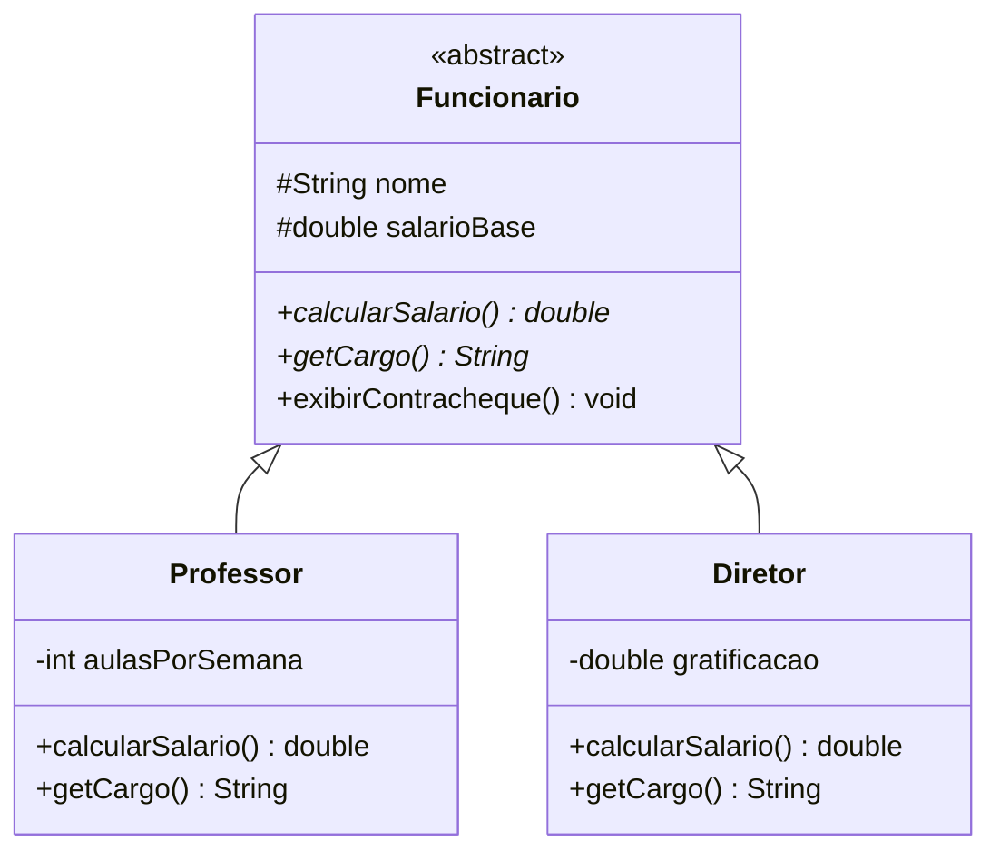
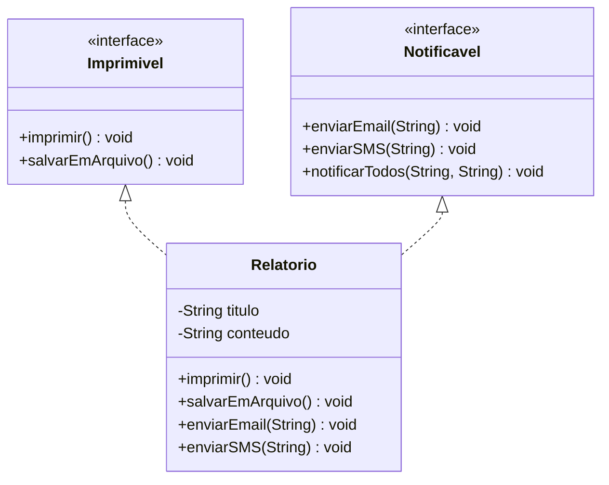

[Índice](../README.md) | [← Anterior: 8. Polimorfismo](../08-polimorfismo/README.md) | [Próximo: 10. Coleções e Estruturas de Dados →](../10-colecoes-e-estruturas-de-dados/README.md)

# 9. Classes Abstratas e Interfaces

> **O que você vai aprender neste capítulo:**
> Criar classes que servem só de modelo (abstratas), definir contratos que as classes devem cumprir (interfaces), entender a diferença entre os dois e saber quando usar cada um.

Até agora todas as classes que criamos podiam ser instanciadas diretamente com `new`. Mas há situacoes em que uma classe existe apenas para ser herdada — ela define uma estrutura comum, mas não faz sentido criar objetos dela diretamente.

Um `Animal` genérico, por exemplo. O que significa criar `new Animal()`? Que animal seria esse? Um animal genérico não existe na natureza — existem cachorros, gatos, vacas. O `Animal` é só um conceito, um modelo. Isso é uma **classe abstrata**: ela define o que todo animal deve ter e fazer, mas não pode ser usada diretamente.

Já as **interfaces** vão além: elas definem um contrato de comportamento que pode ser assinado por qualquer classe, independente da sua hierarquia. Um `Relatorio` pode ser imprimivel e enviavel. Um `Produto` pode ser exportavel e pesquisavel. Interfaces permitem que classes completamente diferentes compartilhem comportamentos comuns sem precisar de uma hierarquia de herança.

Juntas, classes abstratas e interfaces dão ao seu código uma estrutura profissional, extensivel é fácil de manter.


## 9.1 Classes Abstratas — quando usar

```
Use classe abstrata quando:
  - As subclasses COMPARTILHAM codigo em comum
  - Existe uma relacao clara "E UM" (Aluno E UM Funcionario)
  - Voce quer forcas as subclasses a implementar certos metodos

Use interface quando:
  - Classes nao relacionadas precisam do mesmo COMPORTAMENTO
  - Voce quer heranca multipla de comportamento
  - Voce quer definir um CONTRATO
```



```java
// Arquivo: ClassesAbstratas.java

abstract class Funcionario {
    protected String nome;
    protected double salarioBase;

    Funcionario(String nome, double salarioBase) {
        this.nome        = nome;
        this.salarioBase = salarioBase;
    }

    // Método abstrato: obriga subclasses a implementar
    abstract double calcularSalario();
    abstract String getCargo();

    // Método concreto: compartilhado por todos
    void exibirContracheque() {
        IO.println("---");
        IO.println("FUNCIONARIO: " + nome);
        IO.println("CARGO:       " + getCargo());
        IO.println("SALARIO:     R$ " + String.format("%.2f", calcularSalario()));
        IO.println("---");
    }
}

class Professor extends Funcionario {
    private int    aulasPorSemana;
    private static final double VALOR_AULA = 50.0;

    Professor(String nome, double salarioBase, int aulasPorSemana) {
        super(nome, salarioBase);
        this.aulasPorSemana = aulasPorSemana;
    }

    @Override
    double calcularSalario() {
        return salarioBase + (aulasPorSemana * VALOR_AULA * 4);
    }

    @Override
    String getCargo() { return "Professor EBTT"; }
}

class Diretor extends Funcionario {
    private double gratificacao;

    Diretor(String nome, double salarioBase, double gratificacao) {
        super(nome, salarioBase);
        this.gratificacao = gratificacao;
    }

    @Override
    double calcularSalario() { return salarioBase + gratificacao; }

    @Override
    String getCargo() { return "Diretor"; }
}

void main() {
    // Funcionario f = new Funcionario(...); // ERRO: não pode instanciar!

    Funcionario[] equipe = {
        new Professor("Adriano Franca", 4000.00, 20),
        new Diretor("Ana Souza", 6000.00, 2000.00),
        new Professor("Carlos Lima", 3800.00, 18)
    };

    for (Funcionario f : equipe) {
        f.exibirContracheque(); // polimorfismo!
    }
}
```

## 9.2 Interfaces



```java
// Arquivo: Interfaces.java

interface Imprimivel {
    void imprimir();
    void salvarEmArquivo();
}

interface Notificavel {
    void enviarEmail(String dest);
    void enviarSMS(String telefone);

    // Método default: tem implementação padrão (pode ser sobrescrito)
    default void notificarTodos(String dest, String tel) {
        enviarEmail(dest);
        enviarSMS(tel);
    }
}

// Implementando MÚLTIPLAS interfaces
class Relatorio implements Imprimivel, Notificavel {
    private String titulo;
    private String conteudo;

    Relatorio(String titulo, String conteudo) {
        this.titulo   = titulo;
        this.conteudo = conteudo;
    }

    @Override
    public void imprimir() {
        IO.println("==================================================");
        IO.println("RELATORIO: " + titulo);
        IO.println("--------------------------------------------------");
        IO.println(conteudo);
        IO.println("==================================================");
    }

    @Override
    public void salvarEmArquivo() {
        IO.println("'" + titulo + "' salvo em arquivo.");
    }

    @Override
    public void enviarEmail(String dest) {
        IO.println("E-mail para " + dest + ": " + titulo);
    }

    @Override
    public void enviarSMS(String tel) {
        IO.println("SMS para " + tel + ": " + titulo);
    }
}

void main() {
    var rel = new Relatorio("Desempenho Academico", "Media geral: 7.8");
    rel.imprimir();
    rel.notificarTodos("prof@ifpe.edu.br", "(81) 99999-0000");
}
```

## 9.3 Classe Abstrata vs Interface

| | Classe Abstrata | Interface |
|---|---|---|
| Instanciar | Não | Não |
| Herança | `extends` (uma só) | `implements` (varias) |
| Atributos | Pode ter | Só constantes |
| Construtor | Tem | Não tem |
| Métodos concretos | Pode ter | Só `default` |
| **Relação** | "E UM" | "PODE FAZER" |
| **Quando usar** | Compartilhar estrutura e código | Definir contrato/comportamento |

## Erros comuns — Tema 9

```java
// ERRO 1: tentar instanciar classe abstrata
abstract class Forma { }
Forma f = new Forma(); // ERRO: Cannot instantiate abstract class

// ERRO 2: não implementar todos os métodos da interface
interface Imprimivel {
    void imprimir();
    void salvarEmArquivo();
}
class Doc implements Imprimivel {
    public void imprimir() { } // implementou só um!
    // ERRO: Doc não implementa salvarEmArquivo()
}

// ERRO 3: colocar atributo de instância em interface
interface Imprimivel {
    String titulo = "Sem titulo"; // ERRADO: implicitamente static final
    // Não existe atributo de instância em interface!
}

// ERRO 4: confundir "extends" e "implements"
class Aluno implements Pessoa { }   // ERRADO: Pessoa e classe, use extends
class Aluno extends Imprimivel { }  // ERRADO: Imprimivel e interface, use implements
```

## Exercícios — Tema 9

> **Exercício 9.1** — Abstrata `Veiculo` com método abstrato `calcularConsumo(double km)`. Subclasses: `Carro` (10km/L), `Moto` (20km/L), `Caminhao` (4km/L).
>
> **Exercício 9.2** — Interface `Exportavel` com `exportarCSV()`, `exportarJSON()`. Implemente em `RelatorioAlunos` e `RelatorioVendas`.
>
> **Exercício 9.3 (Projeto progressivo)** — Crie interfaces `Vendavel` e `Exportavel`. Faca `Artesao` implementar ambas. `Vendavel` exige `vender(int quantidade)` e `calcularReceita()`. `Exportavel` exige `exportarDados()`.

---

[Índice](../README.md) | [← Anterior: 8. Polimorfismo](../08-polimorfismo/README.md) | [Próximo: 10. Coleções e Estruturas de Dados →](../10-colecoes-e-estruturas-de-dados/README.md)
