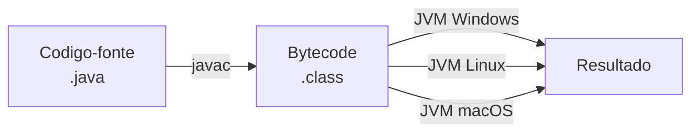

[Índice](../../README.md) | [Próximo: 2. Conceitos Fundamentais de POO →](../02-conceitos-fundamentais-poo/README.md)

# 1. Introdução ao Java e ao JDK 25

> **Códigos deste capítulo:** [codigos/01-introducao-java-jdk25](../../codigos/01-introducao-java-jdk25/)

> **O que você vai aprender neste capítulo:**
> Entender o que é Java, como ele funciona por baixo dos panos, o que mudou no JDK 25 e como configurar seu ambiente de desenvolvimento no VS Code. Ao final, você já vai rodar seu primeiro programa.

Antes de escrever qualquer linha de código orientado a objetos, é preciso conhecer a ferramenta que vamos usar. Java é uma das linguagens mais usadas no mundo há mais de 30 anos — não por acaso, mas porque ela resolve problemas reais de forma organizada, segura e portátil. Neste capítulo você vai entender por que Java ainda domina o mercado corporativo, como o código que você escreve vira um programa que roda em qualquer computador, é como configurar seu ambiente para começar a programar hoje mesmo.


## 1.1 O que é Java?

Java é uma linguagem de programação **orientada a objetos**, **multiplataforma** e **fortemente tipada**, criada pela Sun Microsystems em 1995. Seu slogan histórico e *"Write Once, Run Anywhere"* — escreva uma vez, execute em qualquer lugar.

## 1.2 Como o Java funciona?

```
Voce escreve           Compilador             JVM executa
  o codigo    --->    traduz para   --->   em qualquer sistema
 (.java)              bytecode               operacional
                      (.class)
```



A **JVM** é instalada no sistema operacional e é ela quem executa o bytecode. Por isso o mesmo `.class` roda no Windows, Linux ou macOS sem modificacao.

## 1.3 Novidades do JDK 25 LTS

| Recurso | O que faz | Exemplo |
|---|---|---|
| **Unnamed Classes** | Dispensa `public class` em arquivos simples | `void main() { }` |
| **`java.lang.IO`** | Substituto mais curto de `System.out` | `IO.println("Ola")` |
| **`var`** | Java infere o tipo automaticamente | `var nome = "Maria"` |
| **Records** | Classes de dados com menos código | `record Aluno(String nome, int idade) {}` |
| **Sealed Classes** | Controla quem pode herdar | `sealed class Forma permits Circulo` |

## 1.4 Entendendo o `void main()`

No Java clássico (antes do JDK 21), para rodar qualquer programa era necessário escrever:

```java
public class OlaMundo {
    public static void main(String[] args) {
        System.out.println("Ola!");
    }
}
```

A partir do JDK 25, você pode simplificar para:

```java
void main() {
    IO.println("Ola!");
}
```

### O que cada palavra significa?

| Palavra | Significado | Necessária no JDK 25? |
|---|---|---|
| `public` | Qualquer um pode acessar | Opcional |
| `class NomeArquivo` | Define o molde do programa | Opcional em arquivos simples |
| `static` | Pertence a classe, não ao objeto | Opcional |
| `void` | O método não retorna nenhum valor | **Sim — sempre necessária** |
| `main` | Nome do ponto de entrada do programa | **Sim — sempre necessário** |
| `String[] args` | Argumentos da linha de comando | Opcional |

> **Importante:** `void` não é novidade — sempre existiu. O que o JDK 25 eliminou foi a cerimônia ao redor.

### Quando usar cada forma?

```java
// Forma moderna — JDK 25 (use nas primeiras aulas)
void main() {
    IO.println("Ola, mundo!");
}
```

```java
// Forma clássica — funciona em qualquer versão Java
// Será necessária assim que o projeto tiver múltiplas classes
public class OlaMundo {
    public static void main(String[] args) {
        System.out.println("Ola, mundo!");
    }
}
```

> **Regra prática:** o `void main()` simplificado funciona apenas em arquivos simples com uma única classe. A partir do Tema 6 (Encapsulamento), os exemplos já usam a forma completa.

## 1.5 Configurando o ambiente (VS Code)

**Passo 1 — Instalar o JDK 25:**

```bash
# Baixar em: https://www.oracle.com/java/technologies/downloads/
# Apos instalar, verificar no terminal:
java --version
# Esperado: java 25 ...
```

**Passo 2 — Instalar o VS Code:**

- Baixar em: https://code.visualstudio.com/
- Instalar a extensão **Extension Pack for Java** (Ctrl+Shift+X, pesquisar "Java")

**Passo 3 — Configurar encoding (UTF-8):**

Abrir `settings.json` (Ctrl+Shift+P -> "Open User Settings JSON"):

```json
{
    "files.encoding": "utf8",
    "files.autoGuessEncoding": true,
    "terminal.integrated.env.windows": {
        "JAVA_TOOL_OPTIONS": "-Dfile.encoding=UTF-8"
    }
}
```

> **Nota sobre acentuação:** o terminal do Windows pode apresentar problemas com caracteres acentuados mesmo apóspós a configuração acima. Por isso, nos exemplos de código deste guia, evitamos acentos nas strings para garantir compatibilidade em todos os ambientes.

**Passo 4 — Rodar o primeiro programa:**

```bash
# Compilar e executar diretamente (JDK 25)
java NomeDoArquivo.java

# Ou em dois passos:
javac NomeDoArquivo.java
java NomeDoArquivo
```

## 1.6 Primeiro programa

```java
// Arquivo: OlaMundo.java

void main() {
    // IO.println: forma moderna (JDK 25)
    IO.println("Ola, mundo!");

    // System.out.println: forma clássica
    System.out.println("Ola pelo modo classico!");

    // var: Java infere o tipo automaticamente
    var nome   = "Adriano";   // String
    var idade  = 35;           // int
    var altura = 1.75;         // double

    IO.println("Nome: " + nome + " | Idade: " + idade);
}
```

```
# Saida esperada:
Ola, mundo!
Ola pelo modo classico!
Nome: Adriano | Idade: 35
```

## 1.7 Tipos de dados em Java

Antes de criar classes e objetos, é fundamental entender como o Java lida com os diferentes tipos de informação. Diferente de linguagens como Python, o Java é **fortemente tipado**: toda variável precisa ter um tipo definido, é esse tipo não muda durante a execução.

### Tipos primitivos — armazenam valores simples

São os blocos básicos de dados. Existem 8 tipos primitivos em Java, mas você vai usar principalmente estes:

| Tipo | Tamanho | Faixa de valores | Exemplo |
|---|---|---|---|
| `byte` | 8 bits | -128 a 127 | `byte b = 100;` |
| `short` | 16 bits | -32.768 a 32.767 | `short s = 1000;` |
| `int` | 32 bits | -2 bilhoes a 2 bilhoes | `int idade = 22;` |
| `long` | 64 bits | números muito grandes | `long populacao = 215000000L;` |
| `float` | 32 bits | decimais (menos preciso) | `float pi = 3.14f;` |
| `double` | 64 bits | decimais (mais preciso) | `double altura = 1.75;` |
| `boolean` | 1 bit | `true` ou `false` | `boolean ativo = true;` |
| `char` | 16 bits | um único caractere | `char letra = 'A';` |

> **Regra prática:** use `int` para inteiros, `double` para decimais, `boolean` para verdadeiro/falso e `char` para um único caractere. Os outros tipos aparecem em situacoes específicas.

### String — tipo especial para texto

`String` não é um tipo primitivo — é uma **classe**. Mas é tão usada que parece fazer parte da linguagem. Representa uma sequência de caracteres é sempre fica entre aspas duplas.

```java
// Arquivo: TiposDados.java

void main() {

    // INTEIROS
    int    idade      = 22;
    long   populacao  = 215000000L;  // L no final para long

    // DECIMAIS
    double preco      = 19.99;
    float  taxa       = 0.12f;       // f no final para float

    // TEXTO
    String nome       = "Maria Silva";
    char   inicial    = 'M';         // char usa aspas simples

    // LÓGICO
    boolean aprovado  = true;
    boolean matriculado = false;

    // var: Java infere o tipo automaticamente (JDK 10+)
    var curso   = "Informatica para Internet"; // String
    var semestre = 1;                           // int
    var media    = 8.5;                         // double

    // Exibindo os tipos
    IO.println("Nome: "       + nome);
    IO.println("Idade: "      + idade);
    IO.println("Preco: R$ "   + preco);
    IO.println("Aprovado: "   + aprovado);
    IO.println("Curso: "      + curso);
}
```

```
# Saida esperada:
Nome: Maria Silva
Idade: 22
Preco: R$ 19.99
Aprovado: true
Curso: Informatica para Internet
```

### Conversão entre tipos (casting)

Às vezes você precisa usar um valor de um tipo onde outro tipo é esperado. O Java faz algumas conversões automaticamente — outras precisam ser feitas por você de forma explícita.

**Conversão implícita (widening)** — do tipo menor para o maior. O Java aceita sem reclamar porque não há risco de perda de dados: um `int` cabe perfeitamente num `double`.

```
byte → short → int → long → float → double
                                       ↑
              A seta indica que a conversão é automática nessa direção
```

**Conversão explícita (cast)** — do tipo maior para o menor. Aqui pode haver perda de dados, então o Java exige que você escreva explicitamente `(tipo)` antes do valor, sinalizando que você está ciente do risco. O Java **não arredonda** — ele simplesmente corta a parte que não cabe.

**Conversão entre String e número** — String e números são tipos completamente diferentes. O Java não converte automaticamente entre eles. Para isso existem métodos como `Integer.parseInt()` e `String.valueOf()`.

```java
// Arquivo: Casting.java

void main() {

    // CONVERSÃO IMPLÍCITA: de menor para maior (Java faz automaticamente)
    int    inteiro = 10;
    double decimal = inteiro;   // int -> double, sem perda de dado
    IO.println("Double: " + decimal);  // 10.0

    // CONVERSÃO EXPLÍCITA (cast): de maior para menor (você decide)
    double altura  = 1.758;
    int    arredondado = (int) altura;  // corta os decimais, não arredonda!
    IO.println("Int: " + arredondado); // 1 (não 2!)

    // PROBLEMA CLÁSSICO: divisão de inteiros
    int a = 7, b = 2;
    double errado  = a / b;           // resultado: 3.0 (divisão inteira!)
    double correto = (double) a / b;  // resultado: 3.5
    IO.println("Errado:  " + errado);
    IO.println("Correto: " + correto);

    // CONVERTER String para número
    String textoIdade = "22";
    int    idadeNum   = Integer.parseInt(textoIdade);
    double notaNum    = Double.parseDouble("8.5");
    IO.println("Idade como numero: " + (idadeNum + 1)); // 23

    // CONVERTER número para String
    int    numero = 100;
    String texto  = String.valueOf(numero);  // "100"
    String texto2 = "" + numero;             // forma rápida: "100"
    IO.println("Numero como texto: " + texto);
}
```

```
# Saida esperada:
Double: 10.0
Int: 1
Errado:  3.0
Correto: 3.5
Idade como numero: 23
Numero como texto: 100
```

### Classes wrapper e métodos de conversão

Todo tipo primitivo do Java tem uma **classe correspondente** chamada de *wrapper* (embrulho). Elas servem para duas coisas principais:

- **Fornecer métodos utilitários** — como converter String em número (`parseInt`, `parseDouble`) e obter valores máximos e mínimos do tipo
- **Permitir uso em coleções** — `ArrayList` e `HashMap` não aceitam tipos primitivos, só objetos. Por isso você escreve `ArrayList<Integer>` (wrapper) e não `ArrayList<int>` (primitivo)

O Java faz a conversão entre primitivo e wrapper automaticamente — isso se chama **autoboxing** (primitivo → wrapper) e **unboxing** (wrapper → primitivo).

#### Tabela completa — primitivo, wrapper e parsing

| Primitivo | Wrapper | String → tipo | tipo → String |
|---|---|---|---|
| `int` | `Integer` | `Integer.parseInt("10")` | `Integer.toString(10)` |
| `double` | `Double` | `Double.parseDouble("3.14")` | `Double.toString(3.14)` |
| `float` | `Float` | `Float.parseFloat("3.14")` | `Float.toString(3.14f)` |
| `long` | `Long` | `Long.parseLong("1000000")` | `Long.toString(1000000L)` |
| `boolean` | `Boolean` | `Boolean.parseBoolean("true")` | `Boolean.toString(true)` |
| `byte` | `Byte` | `Byte.parseByte("127")` | `Byte.toString((byte)127)` |
| `short` | `Short` | `Short.parseShort("32000")` | `Short.toString((short)32000)` |
| `char` | `Character` | `texto.charAt(0)` | `Character.toString('A')` |

> **Atalho universal:** `String.valueOf(x)` converte **qualquer tipo** em String — primitivo ou objeto. É a forma mais usada na prática.

#### Exemplos práticos

```java
// Arquivo: ClassesWrapper.java

void main() {

    // PARSING: String -> tipo numerico
    int     idade     = Integer.parseInt("22");
    double  nota      = Double.parseDouble("8.75");
    float   taxa      = Float.parseFloat("0.12");
    long    populacao = Long.parseLong("215000000");
    boolean ativo     = Boolean.parseBoolean("true");

    IO.println("Idade: "     + idade);
    IO.println("Nota: "      + nota);
    IO.println("Taxa: "      + taxa);
    IO.println("Populacao: " + populacao);
    IO.println("Ativo: "     + ativo);

    // WRAPPER: tipo -> String
    String sIdade = Integer.toString(idade);
    String sNota  = Double.toString(nota);
    String sAtivo = Boolean.toString(ativo);

    // Alternativa universal: String.valueOf() aceita qualquer tipo
    String s1 = String.valueOf(idade);     // "22"
    String s2 = String.valueOf(nota);      // "8.75"
    String s3 = String.valueOf(ativo);     // "true"

    IO.println("Como texto: " + s1 + " | " + s2 + " | " + s3);

    // CONSTANTES ÚTEIS das classes wrapper
    IO.println("Maior int:    " + Integer.MAX_VALUE);   // 2147483647
    IO.println("Menor int:    " + Integer.MIN_VALUE);   // -2147483648
    IO.println("Maior double: " + Double.MAX_VALUE);    // 1.7976931348623157E308
    IO.println("Menor double: " + Double.MIN_VALUE);    // 4.9E-324

    // AUTOBOXING: Java converte automaticamente int <-> Integer
    Integer wrapperIdade = idade;          // int -> Integer (autoboxing)
    int     primitivo    = wrapperIdade;   // Integer -> int (unboxing)
    IO.println("Wrapper: " + wrapperIdade);
    IO.println("Primitivo: " + primitivo);

    // CUIDADO: parseBoolean aceita qualquer String
    // só "true" (case insensitive) vira true, qualquer outra coisa vira false
    IO.println(Boolean.parseBoolean("true"));   // true
    IO.println(Boolean.parseBoolean("TRUE"));   // true
    IO.println(Boolean.parseBoolean("sim"));    // false (não e "true")
    IO.println(Boolean.parseBoolean("1"));      // false (não e "true")
}
```

```
# Saida esperada:
Idade: 22
Nota: 8.75
Taxa: 0.12
Populacao: 215000000
Ativo: true
Como texto: 22 | 8.75 | true
Maior int:    2147483647
Menor int:    -2147483648
Maior double: 1.7976931348623157E308
Menor double: 4.9E-324
Wrapper: 22
Primitivo: 22
true
true
false
false
```

> **Atenção com `Boolean.parseBoolean()`:** apenas a string `"true"` (independente de maiúsculas ou minúsculas) retorna `true`. Qualquer outro valor — `"sim"`, `"1"`, `"verdadeiro"` — retorna `false` sem lançar exceção.

### Operadores aritmeticos e de comparação

```java
// Arquivo: Operadores.java

void main() {

    // ARITMETICOS
    int a = 10, b = 3;
    IO.println(a + b);   // 13  — soma
    IO.println(a - b);   // 7   — subtracao
    IO.println(a * b);   // 30  — multiplicacao
    IO.println(a / b);   // 3   — divisão inteira (cuidado!)
    IO.println(a % b);   // 1   — resto da divisão
    IO.println(a++);     // 10  — usa o valor, depois incrementa
    IO.println(++a);     // 12  — incrementa, depois usa o valor

    // COMPARAÇÃO (resultado sempre boolean)
    IO.println(10 == 10);  // true  — igual
    IO.println(10 != 5);   // true  — diferente
    IO.println(10 >  5);   // true  — maior que
    IO.println(10 <  5);   // false — menor que
    IO.println(10 >= 10);  // true  — maior ou igual
    IO.println(10 <= 9);   // false — menor ou igual

    // LÓGICOS
    boolean x = true, y = false;
    IO.println(x && y);   // false — E (ambos verdadeiros)
    IO.println(x || y);   // true  — OU (pelo menos um verdadeiro)
    IO.println(!x);       // false — NÃO (inverte)

    // OPERADOR TERNARIO: condição ? se_verdadeiro : se_falso
    double nota = 7.5;
    String situacao = (nota >= 7.0) ? "Aprovado" : "Reprovado";
    IO.println(situacao);  // Aprovado
}
```

### Trabalhando com String

`String` não é um tipo primitivo — é uma **classe** do Java. Isso significa que ela tem **métodos** (ações que ela sabe executar) e que o Java a trata de forma especial na memória.

Algumas características importantes:

- **Imutável:** uma String nunca muda. Quando você "altera" uma String, o Java cria uma nova na memória e descarta a antiga.
- **Aspas duplas:** Strings sempre ficam entre `"aspas duplas"`. Já `char` fica entre `'aspas simples'`.
- **Índice começa em zero:** o primeiro caractere está na posição 0, o segundo na posição 1, e assim por diante.

```
"Maria Silva"
 M a r i a   S i l v a
 0 1 2 3 4 5 6 7 8 9 10   <- índices
```

#### Métodos mais usados

```java
// Arquivo: Strings.java

void main() {
    String nome = "Maria Silva";

    // INFORMACOES sobre a String
    IO.println(nome.length());           // 11  — número de caracteres
    IO.println(nome.charAt(0));          // M   — caractere na posição 0
    IO.println(nome.indexOf("Silva"));   // 6   — posição onde "Silva" começa
    IO.println(nome.isEmpty());          // false — vazia?
    IO.println(nome.isBlank());          // false — vazia ou só espacos?

    // TRANSFORMACOES (retornam nova String, não mudam a original)
    IO.println(nome.toUpperCase());      // MARIA SILVA
    IO.println(nome.toLowerCase());      // maria silva
    IO.println(nome.trim());             // remove espacos das bordas
    IO.println(nome.strip());            // igual ao trim, mais moderno

    // PARTES da String
    IO.println(nome.substring(0, 5));    // Maria   — do índice 0 até 4
    IO.println(nome.substring(6));       // Silva   — do índice 6 até o fim
    IO.println(nome.replace("Silva", "Santos")); // Maria Santos

    // VERIFICACOES
    IO.println(nome.contains("Silva"));  // true  — contém o texto?
    IO.println(nome.startsWith("Mar"));  // true  — começa com?
    IO.println(nome.endsWith("lva"));    // true  — termina com?

    // DIVISÃO
    String frase = "Java,Python,C++";
    String[] partes = frase.split(",");  // divide pela virgula
    IO.println(partes[0]);               // Java
    IO.println(partes[1]);               // Python
    IO.println(partes[2]);               // C++

    // COMPARAÇÃO: SEMPRE use .equals(), nunca ==
    String s1 = "Java";
    String s2 = "Java";
    IO.println(s1 == s2);               // pode dar true ou false — NÃO confie!
    IO.println(s1.equals(s2));          // true — sempre confiavel
    IO.println(s1.equalsIgnoreCase("java")); // true — ignora maiúsculas

    // CONCATENAÇÃO
    String primeiro = "Joao";
    String ultimo   = "Silva";
    String completo = primeiro + " " + ultimo;         // "Joao Silva"
    String completo2 = primeiro.concat(" ").concat(ultimo); // mesmo resultado

    // CONVERSÃO de número para String
    int    numero = 42;
    String texto  = String.valueOf(numero);   // "42"
    String texto2 = Integer.toString(numero); // "42" — alternativa

    // VERIFICAR se String representa um número antes de converter
    String entrada = "123";
    try {
        int valor = Integer.parseInt(entrada);
        IO.println("Numero valido: " + valor);
    } catch (NumberFormatException e) {
        IO.println("Nao e um numero!");
    }

    // Forma moderna com formatted (JDK 15+)
    String msg = "Aluno: %s | Nota: %.1f".formatted(primeiro, 8.5);
    IO.println(msg);  // Aluno: Joao | Nota: 8.5
}
```

```
# Saida esperada (parcial):
11
M
6
false
MARIA SILVA
maria silva
Maria Silva
Maria
Silva
Maria Santos
true
true
true
Java
Python
C++
false
true
true
Joao Silva
42
Numero valido: 123
Aluno: Joao | Nota: 8.5
```

#### Por que `==` não funciona para String?

Esse é um dos erros mais comuns e mais frustrantes para iniciantes. Entender o porquê ajuda a nunca mais cometê-lo.

```
Memória:               s1 ──→ [ "Java" ]  (endereço 1000)
                       s2 ──→ [ "Java" ]  (endereço 2000)

s1 == s2    compara os ENDEREÇOS: 1000 != 2000 → false (às vezes!)
s1.equals(s2)  compara o CONTEÚDO: "Java" == "Java" → true (sempre!)
```

O operador `==` verifica se duas variáveis apontam para **o mesmo objeto na memória**, não se têm o mesmo conteúdo. `.equals()` compara o **conteúdo** — que é o que queremos.

> **Regra de ouro:** para Strings, sempre use `.equals()`. Para tipos primitivos (`int`, `double`, `boolean`...), use `==` normalmente.

### Saída formatada — System.out.format e printf

Além do `IO.println()` e do `System.out.println()`, o Java oferece uma forma poderosa de exibir dados formatados: o `System.out.format()` (equivalente ao `System.out.printf()`). Ele é ideal quando você precisa controlar casas decimais, alinhar colunas ou montar mensagens com múltiplos valores.

A sintaxe usa **especificadores de formato** iniciados com `%`:

| Especificador | Tipo | Exemplo de uso |
|---|---|---|
| `%s` | String (texto) | `"Nome: %s"` |
| `%d` | Inteiro (`int`, `long`) | `"Idade: %d"` |
| `%f` | Decimal (`float`, `double`) | `"Nota: %f"` |
| `%.2f` | Decimal com 2 casas | `"Preço: %.2f"` |
| `%10s` | String com 10 chars (alinhada à direita) | `"%10s"` |
| `%-10s` | String com 10 chars (alinhada à esquerda) | `"%-10s"` |
| `%05d` | Inteiro com zeros à esquerda | `"%05d"` |
| `%n` | Quebra de linha (equivale a `\n`) | `"Olá%n"` |

```java
// Arquivo: FormatandoSaida.java

void main() {

    // BÁSICO: substituir valores em uma string formatada
    String nome  = "Maria";
    int    idade = 20;
    double nota  = 8.756;

    // System.out.format — semelhante ao printf do C
    System.out.format("Aluno: %s%n", nome);
    System.out.format("Idade: %d anos%n", idade);
    System.out.format("Nota:  %.2f%n", nota);     // 8.76 (arredonda!)

    // Múltiplos valores na mesma linha
    System.out.format("Aluno: %s | Idade: %d | Nota: %.1f%n", nome, idade, nota);

    // TABELA ALINHADA — útil para relatórios no terminal
    System.out.format("%-15s %5s %8s%n", "Nome", "Idade", "Nota");
    System.out.format("%-15s %5d %8.2f%n", "Maria Silva",  20, 8.75);
    System.out.format("%-15s %5d %8.2f%n", "Joao Santos",  22, 7.30);
    System.out.format("%-15s %5d %8.2f%n", "Ana Lima",     19, 9.50);

    // NÚMERO COM ZEROS A ESQUERDA — código de matrícula
    int numero = 42;
    System.out.format("Matricula: 2025-%04d%n", numero); // 2025-0042

    // VALOR MONETÁRIO
    double preco = 1234.5;
    System.out.format("Preco: R$ %,.2f%n", preco); // R$ 1.234,50 (locale BR)

    // String.format — cria string formatada sem imprimir
    String linha = String.format("%-15s | %5.1f", nome, nota);
    IO.println(linha);  // pode usar com IO.println também

    // System.out.printf — idêntico ao format
    System.out.printf("Usando printf: %s tem %.1f%n", nome, nota);
}
```

```
# Saida esperada:
Aluno: Maria
Idade: 20 anos
Nota:  8.76
Aluno: Maria | Idade: 20 | Nota: 8.8
Nome            Idade     Nota
Maria Silva        20     8.75
Joao Santos        22     7.30
Ana Lima           19     9.50
Matricula: 2025-0042
Preco: R$ 1.234,50
Maria            |   8.8
Usando printf: Maria tem 8.8
```

> **Diferença entre as três formas:**
>
> | Método | Comportamento |
> |---|---|
> | `IO.println(x)` | Imprime e pula linha. Simples, sem formatação. |
> | `System.out.println(x)` | Mesmo que acima, forma clássica. |
> | `System.out.format(...)` | Imprime com formatação. **Não pula linha** — use `%n` no final. |
> | `System.out.printf(...)` | Idêntico ao `format`. |
> | `String.format(...)` | Retorna String formatada sem imprimir. |

### Lendo dados do usuário — Scanner e IO.readln()

Até agora só exibimos informações na tela. Mas um programa real precisa também **receber** dados do usuário — nome, idade, nota, escolha de menu. O JDK 25 oferece duas formas de fazer isso.

#### Forma 1 — IO.readln() (novidade do JDK 25)

A forma mais simples. A classe `IO` do JDK 25 tem o método `readln()` que lê uma linha do teclado sem precisar criar nenhum objeto e sem `import`.

```java
// Arquivo: LeitorSimples.java
// JDK 25 compact source file — sem import nenhum!

void main() {
    IO.println("Qual o seu nome?");
    var nome = IO.readln();        // le uma linha do teclado

    IO.println("Qual a sua cidade?");
    var cidade = IO.readln();

    IO.println("Ola, " + nome + " de " + cidade + "!");
}
```

> **Limitação do `IO.readln()`:** só lê texto. Para ler números, você ainda precisa converter com `Integer.parseInt()` ou `Double.parseDouble()`.

```java
// Lendo número com IO.readln() + conversão
void main() {
    IO.println("Qual a sua idade?");
    var idade = Integer.parseInt(IO.readln());  // le texto e converte

    IO.println("Qual a sua nota?");
    var nota = Double.parseDouble(IO.readln()); // le texto e converte

    IO.println("Idade: " + idade + " | Nota: " + nota);
}
```

#### Forma 2 — Scanner (forma completa e mais poderosa)

O `Scanner` é a classe tradicional do Java para leitura de dados. É mais completa que `IO.readln()` — lê inteiros, decimais e textos diretamente, sem precisar converter.

##### Por que precisamos de `import` para o Scanner?

O Java é organizado em **pacotes** — grupos de classes relacionadas. A classe `Scanner` fica no pacote `java.util`, que faz parte do módulo `java.base`.

```
java.util.Scanner         <- pacote.Scanner
   |        |
   |        +-- classe que vamos usar
   +---------- pacote onde ela mora (modulo java.base)
```

A boa notícia: no JDK 25, em **compact source files** (arquivos sem `public class`), todo o módulo `java.base` é importado automaticamente — incluindo `Scanner`. Então o `import` se torna opcional nesses arquivos.

```java
// JDK 25 compact source file — import e OPCIONAL
// Scanner disponível automaticamente via módulo java.base
void main() {
    var sc = new Scanner(System.in);  // funciona sem import!
    IO.println("Nome:");
    var nome = sc.nextLine();
    IO.println("Ola, " + nome);
    sc.close();
}
```

```java
// Quando você criar uma public class, o import volta a ser obrigatório
import java.util.Scanner;  // OBRIGATÓRIO em arquivos com class explícita

public class MeuPrograma {
    public static void main(String[] args) {
        var sc = new Scanner(System.in);
        // ...
    }
}
```

| Situação | `import` necessário? |
|---|---|
| Arquivo com `void main()` sem `class` (compact source file) | **Não** — Scanner automático no JDK 25 |
| Arquivo com `public class MinhaClasse { }` | **Sim** — precisa do `import` |

> **Resumo prático:** enquanto você estiver nos exemplos das primeiras aulas (sem `public class`), não precisa do `import`. Assim que criar uma classe explícita, adicione `import java.util.Scanner;` no topo do arquivo.

#### O que é o Scanner?

`Scanner` é uma classe que lê dados de diferentes fontes — teclado, arquivo, string. Quando passamos `System.in` como argumento, estamos dizendo: "leia do teclado".

```
Usuário digita no teclado
         |
         v
    System.in         <- fluxo de entrada padrão do Java
         |
         v
    Scanner (sc)      <- lê e interpreta o que foi digitado
         |
         v
    variavel = sc.nextLine()  <- armazena o valor lido
```

#### Métodos principais do Scanner

| Método | O que lê | Exemplo |
|---|---|---|
| `nextLine()` | Uma linha inteira de texto | `"Maria Silva"` |
| `next()` | Uma palavra (até o espaço) | `"Maria"` |
| `nextInt()` | Um número inteiro | `22` |
| `nextDouble()` | Um número decimal | `8.75` |
| `nextBoolean()` | `true` ou `false` | `true` |
| `nextLong()` | Um inteiro grande | `215000000` |

#### Exemplo completo com Scanner

```java
// Arquivo: LeitorDados.java
// JDK 25 compact source file: import não necessário aqui
// Em arquivos com public class, adicione: import java.útil.Scanner;

void main() {

    // Cria o Scanner ligado ao teclado (System.in)
    var sc = new Scanner(System.in);

    // Lendo texto
    IO.println("Qual o seu nome?");
    var nome = sc.nextLine();    // le a linha inteira

    // Lendo inteiro
    IO.println("Qual a sua idade?");
    var idade = sc.nextInt();    // le apenas o número

    // Lendo decimal
    IO.println("Qual a sua nota final?");
    var nota = sc.nextDouble();  // le número com casas decimais

    // sc.nextLine() após nextInt/nextDouble: limpa o buffer
    // (explicado abaixo)
    sc.nextLine();

    // Exibindo os dados lidos
    System.out.format("%n=== Dados do Aluno ===%n");
    System.out.format("Nome:  %s%n", nome);
    System.out.format("Idade: %d anos%n", idade);
    System.out.format("Nota:  %.2f%n", nota);

    var situacao = nota >= 7.0 ? "Aprovado" : "Reprovado";
    System.out.format("Situacao: %s%n", situacao);

    // Boa prática: fechar o Scanner ao terminar
    sc.close();
}
```

```
# Exemplo de execução:
Qual o seu nome?
Maria Silva
Qual a sua idade?
20
Qual a sua nota final?
8.75

=== Dados do Aluno ===
Nome:  Maria Silva
Idade: 20 anos
Nota:  8.75
Situacao: Aprovado
```

#### O problema do buffer — nextInt() + nextLine()

Este é o erro mais comum com Scanner. Após `nextInt()` ou `nextDouble()`, o Enter que o usuário pressionou fica "preso" no buffer. Se chamar `nextLine()` em seguida, ele lê esse Enter vazio em vez de esperar o usuário digitar.

```java
// Arquivo: ProblemaBuffer.java
// JDK 25 compact source file: sem import necessário

void main() {
    var sc = new Scanner(System.in);

    IO.println("Digite sua idade:");
    var idade = sc.nextInt();

    // SEM sc.nextLine() de limpeza:
    IO.println("Digite seu nome:");
    var nome = sc.nextLine(); // lê o Enter que ficou do nextInt!
    // nome fica vazio ""

    // SOLUCAO: chamar sc.nextLine() logo após nextInt/nextDouble
    // para descartar o Enter que ficou no buffer
    IO.println("Digite sua cidade:");
    sc.nextLine();            // descarta o Enter residual
    var cidade = sc.nextLine(); // agora lê corretamente

    System.out.format("Idade: %d | Nome: '%s' | Cidade: %s%n",
                      idade, nome, cidade);
    sc.close();
}
```

> **Regra prática:** sempre que usar `nextInt()` ou `nextDouble()` e depois precisar de `nextLine()`, adicione um `sc.nextLine()` entre eles para limpar o buffer.

#### Quando usar IO.readln() e quando usar Scanner?

| | `IO.readln()` | `Scanner` |
|---|---|---|
| **Import necessário** | Nunca | Só em arquivos com `public class` |
| **Lê texto** | Sim | Sim — `nextLine()` |
| **Lê inteiro direto** | Não — precisa converter | Sim — `nextInt()` |
| **Lê decimal direto** | Não — precisa converter | Sim — `nextDouble()` |
| **Problema do buffer** | Não existe | Existe (nextInt + nextLine) |
| **Quando usar** | Programas simples, primeiras aulas | Quando precisar de mais controle |

## Exercícios — Tema 1

> **Exercício 1.1** — Crie `Apresentacao.java` que exiba seu nome, cidade e curso usando `IO.println()`.
>
> **Exercício 1.2** — Declare variáveis dos 6 tipos principais (`int`, `long`, `double`, `boolean`, `char`, `String`) com valores que representem dados de um aluno. Exiba todas usando `System.out.format()`, com a nota com 2 casas decimais e a matrícula com zeros à esquerda.
>
> **Exercício 1.3** — Crie `Casting.java` e reproduza o exemplo de casting do guia. Depois experimente: o que acontece ao converter `3.9` para `int`? E `'A'` para `int`? Anote os resultados nos comentarios.
>
> **Exercício 1.4** — Crie `Strings.java` e use pelo menos 5 métodos de String diferentes com o seu próprio nome completo. Exiba o resultado de cada operação.
>
> **Exercício 1.5** — Crie `Relatorio.java` que usa `System.out.format()` para exibir uma tabela com pelo menos 4 alunos fictícios, com colunas alinhadas: Nome (15 chars, esquerda), Matrícula (formato `2025-0000`) e Nota (2 casas decimais). Exiba também a média da turma ao final.
>
> **Exercício 1.6** — Crie duas versões de `CadastroAluno.java`: uma usando `IO.readln()` com conversão manual e outra usando `Scanner`. Compare as duas abordagens. Em ambas, exiba os dados com `System.out.format()` e inclua a situação (Aprovado/Reprovado).
>
> **Exercício 1.7** — Pesquise e comente no código: qual a diferença entre JDK, JRE e JVM? Qual você instalou e por que?

---

[Índice](../../README.md) | [Próximo: 2. Conceitos Fundamentais de POO →](../02-conceitos-fundamentais-poo/README.md)
