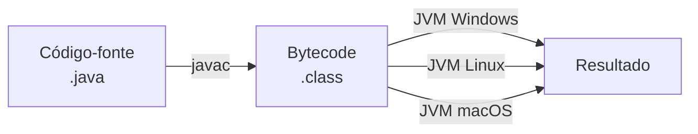
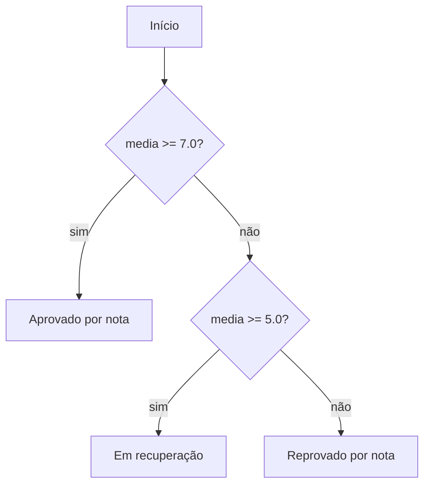

[Índice](../../README.md) | [Próximo: 2. Conceitos Fundamentais de POO →](../02-conceitos-fundamentais-poo/README.md)

# 1. Introdução ao Java e ao JDK 25

> **Códigos deste capítulo:** [codigos/01-introducao-java-jdk25](../../codigos/01-introducao-java-jdk25/)

> **O que você vai aprender neste capítulo:**
> Entender o que é Java, como ele funciona por baixo dos panos, o que mudou no JDK 25 e como configurar seu ambiente de desenvolvimento no VS Code. Você também vai aprender a tomar decisões e repetir tarefas com `if`, `switch` e laços, e a guardar vários valores em arrays. Ao final, você já vai rodar seus primeiros programas.

Antes de escrever qualquer linha de código orientado a objetos, é preciso conhecer a ferramenta que vamos usar. Java é uma das linguagens mais usadas no mundo há mais de 30 anos — não por acaso, mas porque ela resolve problemas reais de forma organizada, segura e portátil. Neste capítulo você vai entender por que Java ainda domina o mercado corporativo, como o código que você escreve vira um programa que roda em qualquer computador, é como configurar seu ambiente para começar a programar hoje mesmo.


## 1.1 O que é Java?

Java é uma linguagem de programação **orientada a objetos**, **multiplataforma** e **fortemente tipada**, criada pela Sun Microsystems em 1995. Seu slogan histórico e *"Write Once, Run Anywhere"* — escreva uma vez, execute em qualquer lugar.

## 1.2 Como o Java funciona?

```
Você escreve           Compilador             JVM executa
  o código    --->    traduz para   --->   em qualquer sistema
 (.java)              bytecode               operacional
                      (.class)
```



A **JVM** é instalada no sistema operacional e é ela quem executa o bytecode. Por isso o mesmo `.class` roda no Windows, Linux ou macOS sem modificação.

## 1.3 Novidades do JDK 25 LTS

| Recurso | O que faz | Exemplo |
|---|---|---|
| **Unnamed Classes** | Dispensa `public class` em arquivos simples | `void main() { }` |
| **`java.lang.IO`** | Substituto mais curto de `System.out` | `IO.println("Ola")` |
| **`var`** | Java infere o tipo automaticamente | `var nome = "Maria"` |
| **Records** | Classes de dados com menos código | `record Aluno(String nome, int idade) {}` |
| **Sealed Classes** | Controla quem pode herdar | `sealed class Forma permits Circulo` |

## 1.4 Entendendo o `void main()`

No Java clássico (antes do JDK 21), para rodar qualquer programa era necessário escrever:

```java
public class OlaMundo {
    public static void main(String[] args) {
        System.out.println("Olá!");
    }
}
```

A partir do JDK 25, você pode simplificar para:

```java
void main() {
    IO.println("Olá!");
}
```

### O que cada palavra significa?

| Palavra | Significado | Necessária no JDK 25? |
|---|---|---|
| `public` | Qualquer um pode acessar | Opcional |
| `class NomeArquivo` | Define o molde do programa | Opcional em arquivos simples |
| `static` | Pertence à classe, não ao objeto | Opcional |
| `void` | O método não retorna nenhum valor | **Sim — sempre necessária** |
| `main` | Nome do ponto de entrada do programa | **Sim — sempre necessário** |
| `String[] args` | Argumentos da linha de comando | Opcional |

> **Importante:** `void` não é novidade — sempre existiu. O que o JDK 25 eliminou foi a cerimônia ao redor.

### Quando usar cada forma?

```java
// Forma moderna — JDK 25 (use nas primeiras aulas)
void main() {
    IO.println("Olá, mundo!");
}
```

```java
// Forma clássica — funciona em qualquer versão Java
// Será necessária assim que o projeto tiver múltiplas classes
public class OlaMundo {
    public static void main(String[] args) {
        System.out.println("Olá, mundo!");
    }
}
```

> **Regra prática:** o `void main()` simplificado funciona apenas em arquivos simples com uma única classe. A partir do Tema 6 (Encapsulamento), os exemplos já usam a forma completa.

## 1.5 Configurando o ambiente (VS Code)

**Passo 1 — Instalar o JDK 25:**

```bash
# Baixar em: https://www.oracle.com/java/technologies/downloads/
# Apos instalar, verificar no terminal:
java --version
# Esperado: java 25 ...
```

**Passo 2 — Instalar o VS Code:**

- Baixar em: https://code.visualstudio.com/
- Instalar a extensão **Extension Pack for Java** (Ctrl+Shift+X, pesquisar "Java")

**Passo 3 — Configurar encoding (UTF-8):**

Abrir `settings.json` (Ctrl+Shift+P -> "Open User Settings JSON"):

```json
{
    "files.encoding": "utf8",
    "files.autoGuessEncoding": true,
    "terminal.integrated.env.windows": {
        "JAVA_TOOL_OPTIONS": "-Dfile.encoding=UTF-8 -Dstdout.encoding=UTF-8"
    }
}
```

> **Nota sobre acentuação:** os exemplos deste guia usam acentos nos textos e comentários, e o Java 25 lê o código-fonte em UTF-8 por padrão. A opção `-Dstdout.encoding=UTF-8` faz a **saída** do programa também sair em UTF-8. Se mesmo assim aparecerem símbolos estranhos (`?` ou `ã`) no terminal do Windows, digite `chcp 65001` antes de executar o programa, ou rode pelo terminal integrado do VS Code configurado acima. Salve sempre os arquivos `.java` em UTF-8.

**Passo 4 — Rodar o primeiro programa:**

```bash
# Compilar e executar diretamente (JDK 25)
java NomeDoArquivo.java

# Ou em dois passos:
javac NomeDoArquivo.java
java NomeDoArquivo
```

## 1.6 Primeiro programa

```java
// Arquivo: OlaMundo.java

void main() {
    // IO.println: forma moderna (JDK 25)
    IO.println("Olá, mundo!");

    // System.out.println: forma clássica
    System.out.println("Olá pelo modo clássico!");

    // var: Java infere o tipo automaticamente
    var nome   = "Adriano";   // String
    var idade  = 35;           // int
    var altura = 1.75;         // double

    IO.println("Nome: " + nome + " | Idade: " + idade);
}
```

```
# Saída esperada:
Olá, mundo!
Olá pelo modo clássico!
Nome: Adriano | Idade: 35
```

## 1.7 Tipos de dados em Java

Antes de criar classes e objetos, é fundamental entender como o Java lida com os diferentes tipos de informação. Diferente de linguagens como Python, o Java é **fortemente tipado**: toda variável precisa ter um tipo definido, é esse tipo não muda durante a execução.

### Tipos primitivos — armazenam valores simples

São os blocos básicos de dados. Existem 8 tipos primitivos em Java, mas você vai usar principalmente estes:

| Tipo | Tamanho | Faixa de valores | Exemplo |
|---|---|---|---|
| `byte` | 8 bits | -128 a 127 | `byte b = 100;` |
| `short` | 16 bits | -32.768 a 32.767 | `short s = 1000;` |
| `int` | 32 bits | -2 bilhões a 2 bilhões | `int idade = 22;` |
| `long` | 64 bits | números muito grandes | `long populacao = 215000000L;` |
| `float` | 32 bits | decimais (menos preciso) | `float pi = 3.14f;` |
| `double` | 64 bits | decimais (mais preciso) | `double altura = 1.75;` |
| `boolean` | 1 bit | `true` ou `false` | `boolean ativo = true;` |
| `char` | 16 bits | um único caractere | `char letra = 'A';` |

> **Regra prática:** use `int` para inteiros, `double` para decimais, `boolean` para verdadeiro/falso e `char` para um único caractere. Os outros tipos aparecem em situações específicas.

### String — tipo especial para texto

`String` não é um tipo primitivo — é uma **classe**. Mas é tão usada que parece fazer parte da linguagem. Representa uma sequência de caracteres é sempre fica entre aspas duplas.

```java
// Arquivo: TiposDados.java

void main() {

    // INTEIROS
    int    idade      = 22;
    long   populacao  = 215000000L;  // L no final para long

    // DECIMAIS
    double preco      = 19.99;
    float  taxa       = 0.12f;       // f no final para float

    // TEXTO
    String nome       = "Maria Silva";
    char   inicial    = 'M';         // char usa aspas simples

    // LÓGICO
    boolean aprovado  = true;
    boolean matriculado = false;

    // var: Java infere o tipo automaticamente (JDK 10+)
    var curso   = "Informática para Internet"; // String
    var semestre = 1;                           // int
    var media    = 8.5;                         // double

    // Exibindo os tipos
    IO.println("Nome: "       + nome);
    IO.println("Idade: "      + idade);
    IO.println("Preço: R$ "   + preco);
    IO.println("Aprovado: "   + aprovado);
    IO.println("Curso: "      + curso);
}
```

```
# Saída esperada:
Nome: Maria Silva
Idade: 22
Preço: R$ 19.99
Aprovado: true
Curso: Informática para Internet
```

### Conversão entre tipos (casting)

Às vezes você precisa usar um valor de um tipo onde outro tipo é esperado. O Java faz algumas conversões automaticamente — outras precisam ser feitas por você de forma explícita.

**Conversão implícita (widening)** — do tipo menor para o maior. O Java aceita sem reclamar porque não há risco de perda de dados: um `int` cabe perfeitamente num `double`.

```
byte → short → int → long → float → double
                                       ↑
              A seta indica que a conversão é automática nessa direção
```

**Conversão explícita (cast)** — do tipo maior para o menor. Aqui pode haver perda de dados, então o Java exige que você escreva explicitamente `(tipo)` antes do valor, sinalizando que você está ciente do risco. O Java **não arredonda** — ele simplesmente corta a parte que não cabe.

**Conversão entre String e número** — String e números são tipos completamente diferentes. O Java não converte automaticamente entre eles. Para isso existem métodos como `Integer.parseInt()` e `String.valueOf()`.

```java
// Arquivo: Casting.java

void main() {

    // CONVERSÃO IMPLÍCITA: de menor para maior (Java faz automaticamente)
    int    inteiro = 10;
    double decimal = inteiro;   // int -> double, sem perda de dado
    IO.println("Double: " + decimal);  // 10.0

    // CONVERSÃO EXPLÍCITA (cast): de maior para menor (você decide)
    double altura  = 1.758;
    int    arredondado = (int) altura;  // corta os decimais, não arredonda!
    IO.println("Int: " + arredondado); // 1 (não 2!)

    // PROBLEMA CLÁSSICO: divisão de inteiros
    int a = 7, b = 2;
    double errado  = a / b;           // resultado: 3.0 (divisão inteira!)
    double correto = (double) a / b;  // resultado: 3.5
    IO.println("Errado:  " + errado);
    IO.println("Correto: " + correto);

    // CONVERTER String para número
    String textoIdade = "22";
    int    idadeNum   = Integer.parseInt(textoIdade);
    double notaNum    = Double.parseDouble("8.5");
    IO.println("Idade como número: " + (idadeNum + 1)); // 23

    // CONVERTER número para String
    int    numero = 100;
    String texto  = String.valueOf(numero);  // "100"
    String texto2 = "" + numero;             // forma rápida: "100"
    IO.println("Número como texto: " + texto);
}
```

```
# Saída esperada:
Double: 10.0
Int: 1
Errado:  3.0
Correto: 3.5
Idade como número: 23
Número como texto: 100
```

### Classes wrapper e métodos de conversão

Todo tipo primitivo do Java tem uma **classe correspondente** chamada de *wrapper* (embrulho). Elas servem para duas coisas principais:

- **Fornecer métodos utilitários** — como converter String em número (`parseInt`, `parseDouble`) e obter valores máximos e mínimos do tipo
- **Permitir uso em coleções** — `ArrayList` e `HashMap` não aceitam tipos primitivos, só objetos. Por isso você escreve `ArrayList<Integer>` (wrapper) e não `ArrayList<int>` (primitivo)

O Java faz a conversão entre primitivo e wrapper automaticamente — isso se chama **autoboxing** (primitivo → wrapper) e **unboxing** (wrapper → primitivo).

#### Tabela completa — primitivo, wrapper e parsing

| Primitivo | Wrapper | String → tipo | tipo → String |
|---|---|---|---|
| `int` | `Integer` | `Integer.parseInt("10")` | `Integer.toString(10)` |
| `double` | `Double` | `Double.parseDouble("3.14")` | `Double.toString(3.14)` |
| `float` | `Float` | `Float.parseFloat("3.14")` | `Float.toString(3.14f)` |
| `long` | `Long` | `Long.parseLong("1000000")` | `Long.toString(1000000L)` |
| `boolean` | `Boolean` | `Boolean.parseBoolean("true")` | `Boolean.toString(true)` |
| `byte` | `Byte` | `Byte.parseByte("127")` | `Byte.toString((byte)127)` |
| `short` | `Short` | `Short.parseShort("32000")` | `Short.toString((short)32000)` |
| `char` | `Character` | `texto.charAt(0)` | `Character.toString('A')` |

> **Atalho universal:** `String.valueOf(x)` converte **qualquer tipo** em String — primitivo ou objeto. É a forma mais usada na prática.

#### Exemplos práticos

```java
// Arquivo: ClassesWrapper.java

void main() {

    // PARSING: String -> tipo numérico
    int     idade     = Integer.parseInt("22");
    double  nota      = Double.parseDouble("8.75");
    float   taxa      = Float.parseFloat("0.12");
    long    populacao = Long.parseLong("215000000");
    boolean ativo     = Boolean.parseBoolean("true");

    IO.println("Idade: "     + idade);
    IO.println("Nota: "      + nota);
    IO.println("Taxa: "      + taxa);
    IO.println("População: " + populacao);
    IO.println("Ativo: "     + ativo);

    // WRAPPER: tipo -> String
    String sIdade = Integer.toString(idade);
    String sNota  = Double.toString(nota);
    String sAtivo = Boolean.toString(ativo);

    // Alternativa universal: String.valueOf() aceita qualquer tipo
    String s1 = String.valueOf(idade);     // "22"
    String s2 = String.valueOf(nota);      // "8.75"
    String s3 = String.valueOf(ativo);     // "true"

    IO.println("Como texto: " + s1 + " | " + s2 + " | " + s3);

    // CONSTANTES ÚTEIS das classes wrapper
    IO.println("Maior int:    " + Integer.MAX_VALUE);   // 2147483647
    IO.println("Menor int:    " + Integer.MIN_VALUE);   // -2147483648
    IO.println("Maior double: " + Double.MAX_VALUE);    // 1.7976931348623157E308
    IO.println("Menor double: " + Double.MIN_VALUE);    // 4.9E-324

    // AUTOBOXING: Java converte automaticamente int <-> Integer
    Integer wrapperIdade = idade;          // int -> Integer (autoboxing)
    int     primitivo    = wrapperIdade;   // Integer -> int (unboxing)
    IO.println("Wrapper: " + wrapperIdade);
    IO.println("Primitivo: " + primitivo);

    // CUIDADO: parseBoolean aceita qualquer String
    // só "true" (case insensitive) vira true, qualquer outra coisa vira false
    IO.println(Boolean.parseBoolean("true"));   // true
    IO.println(Boolean.parseBoolean("TRUE"));   // true
    IO.println(Boolean.parseBoolean("sim"));    // false (não e "true")
    IO.println(Boolean.parseBoolean("1"));      // false (não e "true")
}
```

```
# Saída esperada:
Idade: 22
Nota: 8.75
Taxa: 0.12
População: 215000000
Ativo: true
Como texto: 22 | 8.75 | true
Maior int:    2147483647
Menor int:    -2147483648
Maior double: 1.7976931348623157E308
Menor double: 4.9E-324
Wrapper: 22
Primitivo: 22
true
true
false
false
```

> **Atenção com `Boolean.parseBoolean()`:** apenas a string `"true"` (independente de maiúsculas ou minúsculas) retorna `true`. Qualquer outro valor — `"sim"`, `"1"`, `"verdadeiro"` — retorna `false` sem lançar exceção.

### Operadores aritméticos e de comparação

```java
// Arquivo: Operadores.java

void main() {

    // ARITMÉTICOS
    int a = 10, b = 3;
    IO.println(a + b);   // 13  — soma
    IO.println(a - b);   // 7   — subtração
    IO.println(a * b);   // 30  — multiplicação
    IO.println(a / b);   // 3   — divisão inteira (cuidado!)
    IO.println(a % b);   // 1   — resto da divisão
    IO.println(a++);     // 10  — usa o valor, depois incrementa
    IO.println(++a);     // 12  — incrementa, depois usa o valor

    // COMPARAÇÃO (resultado sempre boolean)
    IO.println(10 == 10);  // true  — igual
    IO.println(10 != 5);   // true  — diferente
    IO.println(10 >  5);   // true  — maior que
    IO.println(10 <  5);   // false — menor que
    IO.println(10 >= 10);  // true  — maior ou igual
    IO.println(10 <= 9);   // false — menor ou igual

    // LÓGICOS
    boolean x = true, y = false;
    IO.println(x && y);   // false — E (ambos verdadeiros)
    IO.println(x || y);   // true  — OU (pelo menos um verdadeiro)
    IO.println(!x);       // false — NÃO (inverte)

    // OPERADOR TERNÁRIO: condição ? se_verdadeiro : se_falso
    double nota = 7.5;
    String situacao = (nota >= 7.0) ? "Aprovado" : "Reprovado";
    IO.println(situacao);  // Aprovado
}
```

### Trabalhando com String

`String` não é um tipo primitivo — é uma **classe** do Java. Isso significa que ela tem **métodos** (ações que ela sabe executar) e que o Java a trata de forma especial na memória.

Algumas características importantes:

- **Imutável:** uma String nunca muda. Quando você "altera" uma String, o Java cria uma nova na memória e descarta a antiga.
- **Aspas duplas:** Strings sempre ficam entre `"aspas duplas"`. Já `char` fica entre `'aspas simples'`.
- **Índice começa em zero:** o primeiro caractere está na posição 0, o segundo na posição 1, e assim por diante.

```
"Maria Silva"
 M a r i a   S i l v a
 0 1 2 3 4 5 6 7 8 9 10   <- índices
```

#### Métodos mais usados

```java
// Arquivo: Strings.java

void main() {
    String nome = "Maria Silva";

    // INFORMAÇÕES sobre a String
    IO.println(nome.length());           // 11  — número de caracteres
    IO.println(nome.charAt(0));          // M   — caractere na posição 0
    IO.println(nome.indexOf("Silva"));   // 6   — posição onde "Silva" começa
    IO.println(nome.isEmpty());          // false — vazia?
    IO.println(nome.isBlank());          // false — vazia ou só espaços?

    // TRANSFORMAÇÕES (retornam nova String, não mudam a original)
    IO.println(nome.toUpperCase());      // MARIA SILVA
    IO.println(nome.toLowerCase());      // maria silva
    IO.println(nome.trim());             // remove espaços das bordas
    IO.println(nome.strip());            // igual ao trim, mais moderno

    // PARTES da String
    IO.println(nome.substring(0, 5));    // Maria   — do índice 0 até 4
    IO.println(nome.substring(6));       // Silva   — do índice 6 até o fim
    IO.println(nome.replace("Silva", "Santos")); // Maria Santos

    // VERIFICAÇÕES
    IO.println(nome.contains("Silva"));  // true  — contém o texto?
    IO.println(nome.startsWith("Mar"));  // true  — começa com?
    IO.println(nome.endsWith("lva"));    // true  — termina com?

    // DIVISÃO
    String frase = "Java,Python,C++";
    String[] partes = frase.split(",");  // divide pela vírgula
    IO.println(partes[0]);               // Java
    IO.println(partes[1]);               // Python
    IO.println(partes[2]);               // C++

    // COMPARAÇÃO: SEMPRE use .equals(), nunca ==
    String s1 = "Java";
    String s2 = "Java";
    IO.println(s1 == s2);               // pode dar true ou false — NÃO confie!
    IO.println(s1.equals(s2));          // true — sempre confiável
    IO.println(s1.equalsIgnoreCase("java")); // true — ignora maiúsculas

    // CONCATENAÇÃO
    String primeiro = "João";
    String ultimo   = "Silva";
    String completo = primeiro + " " + ultimo;         // "João Silva"
    String completo2 = primeiro.concat(" ").concat(ultimo); // mesmo resultado

    // CONVERSÃO de número para String
    int    numero = 42;
    String texto  = String.valueOf(numero);   // "42"
    String texto2 = Integer.toString(numero); // "42" — alternativa

    // VERIFICAR se String representa um número antes de converter
    String entrada = "123";
    try {
        int valor = Integer.parseInt(entrada);
        IO.println("Número válido: " + valor);
    } catch (NumberFormatException e) {
        IO.println("Não é um número!");
    }

    // Forma moderna com formatted (JDK 15+)
    String msg = "Aluno: %s | Nota: %.1f".formatted(primeiro, 8.5);
    IO.println(msg);  // Aluno: João | Nota: 8.5
}
```

```
# Saída esperada (parcial):
11
M
6
false
MARIA SILVA
maria silva
Maria Silva
Maria
Silva
Maria Santos
true
true
true
Java
Python
C++
false
true
true
João Silva
42
Número válido: 123
Aluno: João | Nota: 8.5
```

#### Por que `==` não funciona para String?

Esse é um dos erros mais comuns e mais frustrantes para iniciantes. Entender o porquê ajuda a nunca mais cometê-lo.

```
Memória:               s1 ──→ [ "Java" ]  (endereço 1000)
                       s2 ──→ [ "Java" ]  (endereço 2000)

s1 == s2    compara os ENDEREÇOS: 1000 != 2000 → false (às vezes!)
s1.equals(s2)  compara o CONTEÚDO: "Java" == "Java" → true (sempre!)
```

O operador `==` verifica se duas variáveis apontam para **o mesmo objeto na memória**, não se têm o mesmo conteúdo. `.equals()` compara o **conteúdo** — que é o que queremos.

> **Regra de ouro:** para Strings, sempre use `.equals()`. Para tipos primitivos (`int`, `double`, `boolean`...), use `==` normalmente.

### Saída formatada — System.out.format e printf

Além do `IO.println()` e do `System.out.println()`, o Java oferece uma forma poderosa de exibir dados formatados: o `System.out.format()` (equivalente ao `System.out.printf()`). Ele é ideal quando você precisa controlar casas decimais, alinhar colunas ou montar mensagens com múltiplos valores.

A sintaxe usa **especificadores de formato** iniciados com `%`:

| Especificador | Tipo | Exemplo de uso |
|---|---|---|
| `%s` | String (texto) | `"Nome: %s"` |
| `%d` | Inteiro (`int`, `long`) | `"Idade: %d"` |
| `%f` | Decimal (`float`, `double`) | `"Nota: %f"` |
| `%.2f` | Decimal com 2 casas | `"Preço: %.2f"` |
| `%10s` | String com 10 chars (alinhada à direita) | `"%10s"` |
| `%-10s` | String com 10 chars (alinhada à esquerda) | `"%-10s"` |
| `%05d` | Inteiro com zeros à esquerda | `"%05d"` |
| `%n` | Quebra de linha (equivale a `\n`) | `"Olá%n"` |

```java
// Arquivo: FormatandoSaida.java

void main() {

    // BÁSICO: substituir valores em uma string formatada
    String nome  = "Maria";
    int    idade = 20;
    double nota  = 8.756;

    // System.out.format — semelhante ao printf do C
    System.out.format("Aluno: %s%n", nome);
    System.out.format("Idade: %d anos%n", idade);
    System.out.format("Nota:  %.2f%n", nota);     // 8.76 (arredonda!)

    // Múltiplos valores na mesma linha
    System.out.format("Aluno: %s | Idade: %d | Nota: %.1f%n", nome, idade, nota);

    // TABELA ALINHADA — útil para relatórios no terminal
    System.out.format("%-15s %5s %8s%n", "Nome", "Idade", "Nota");
    System.out.format("%-15s %5d %8.2f%n", "Maria Silva",  20, 8.75);
    System.out.format("%-15s %5d %8.2f%n", "João Santos",  22, 7.30);
    System.out.format("%-15s %5d %8.2f%n", "Ana Lima",     19, 9.50);

    // NÚMERO COM ZEROS A ESQUERDA — código de matrícula
    int numero = 42;
    System.out.format("Matrícula: 2025-%04d%n", numero); // 2025-0042

    // VALOR MONETÁRIO
    double preco = 1234.5;
    System.out.format("Preço: R$ %,.2f%n", preco); // R$ 1.234,50 (locale BR)

    // String.format — cria string formatada sem imprimir
    String linha = String.format("%-15s | %5.1f", nome, nota);
    IO.println(linha);  // pode usar com IO.println também

    // System.out.printf — idêntico ao format
    System.out.printf("Usando printf: %s tem %.1f%n", nome, nota);
}
```

```
# Saída esperada:
Aluno: Maria
Idade: 20 anos
Nota:  8.76
Aluno: Maria | Idade: 20 | Nota: 8.8
Nome            Idade     Nota
Maria Silva        20     8.75
João Santos        22     7.30
Ana Lima           19     9.50
Matrícula: 2025-0042
Preço: R$ 1.234,50
Maria            |   8.8
Usando printf: Maria tem 8.8
```

> **Diferença entre as três formas:**
>
> | Método | Comportamento |
> |---|---|
> | `IO.println(x)` | Imprime e pula linha. Simples, sem formatação. |
> | `System.out.println(x)` | Mesmo que acima, forma clássica. |
> | `System.out.format(...)` | Imprime com formatação. **Não pula linha** — use `%n` no final. |
> | `System.out.printf(...)` | Idêntico ao `format`. |
> | `String.format(...)` | Retorna String formatada sem imprimir. |

### Lendo dados do usuário — Scanner e IO.readln()

Até agora só exibimos informações na tela. Mas um programa real precisa também **receber** dados do usuário — nome, idade, nota, escolha de menu. O JDK 25 oferece duas formas de fazer isso.

#### Forma 1 — IO.readln() (novidade do JDK 25)

A forma mais simples. A classe `IO` do JDK 25 tem o método `readln()` que lê uma linha do teclado sem precisar criar nenhum objeto e sem `import`.

```java
// Arquivo: LeitorSimples.java
// JDK 25 compact source file — sem import nenhum!

void main() {
    IO.println("Qual o seu nome?");
    var nome = IO.readln();        // lê uma linha do teclado

    IO.println("Qual a sua cidade?");
    var cidade = IO.readln();

    IO.println("Olá, " + nome + " de " + cidade + "!");
}
```

> **Limitação do `IO.readln()`:** só lê texto. Para ler números, você ainda precisa converter com `Integer.parseInt()` ou `Double.parseDouble()`.

```java
// Lendo número com IO.readln() + conversão
void main() {
    IO.println("Qual a sua idade?");
    var idade = Integer.parseInt(IO.readln());  // lê texto e converte

    IO.println("Qual a sua nota?");
    var nota = Double.parseDouble(IO.readln()); // lê texto e converte

    IO.println("Idade: " + idade + " | Nota: " + nota);
}
```

#### Forma 2 — Scanner (forma completa e mais poderosa)

O `Scanner` é a classe tradicional do Java para leitura de dados. É mais completa que `IO.readln()` — lê inteiros, decimais e textos diretamente, sem precisar converter.

##### Por que precisamos de `import` para o Scanner?

O Java é organizado em **pacotes** — grupos de classes relacionadas. A classe `Scanner` fica no pacote `java.util`, que faz parte do módulo `java.base`.

```
java.util.Scanner         <- pacote.Scanner
   |        |
   |        +-- classe que vamos usar
   +---------- pacote onde ela mora (módulo java.base)
```

A boa notícia: no JDK 25, em **compact source files** (arquivos sem `public class`), todo o módulo `java.base` é importado automaticamente — incluindo `Scanner`. Então o `import` se torna opcional nesses arquivos.

```java
// JDK 25 compact source file — import é OPCIONAL
// Scanner disponível automaticamente via módulo java.base
void main() {
    var sc = new Scanner(System.in);  // funciona sem import!
    IO.println("Nome:");
    var nome = sc.nextLine();
    IO.println("Olá, " + nome);
    sc.close();
}
```

```java
// Quando você criar uma public class, o import volta a ser obrigatório
import java.util.Scanner;  // OBRIGATÓRIO em arquivos com class explícita

public class MeuPrograma {
    public static void main(String[] args) {
        var sc = new Scanner(System.in);
        // ...
    }
}
```

| Situação | `import` necessário? |
|---|---|
| Arquivo com `void main()` sem `class` (compact source file) | **Não** — Scanner automático no JDK 25 |
| Arquivo com `public class MinhaClasse { }` | **Sim** — precisa do `import` |

> **Resumo prático:** enquanto você estiver nos exemplos das primeiras aulas (sem `public class`), não precisa do `import`. Assim que criar uma classe explícita, adicione `import java.util.Scanner;` no topo do arquivo.

#### O que é o Scanner?

`Scanner` é uma classe que lê dados de diferentes fontes — teclado, arquivo, string. Quando passamos `System.in` como argumento, estamos dizendo: "leia do teclado".

```
Usuário digita no teclado
         |
         v
    System.in         <- fluxo de entrada padrão do Java
         |
         v
    Scanner (sc)      <- lê e interpreta o que foi digitado
         |
         v
    variavel = sc.nextLine()  <- armazena o valor lido
```

#### Métodos principais do Scanner

| Método | O que lê | Exemplo |
|---|---|---|
| `nextLine()` | Uma linha inteira de texto | `"Maria Silva"` |
| `next()` | Uma palavra (até o espaço) | `"Maria"` |
| `nextInt()` | Um número inteiro | `22` |
| `nextDouble()` | Um número decimal | `8.75` |
| `nextBoolean()` | `true` ou `false` | `true` |
| `nextLong()` | Um inteiro grande | `215000000` |

#### Exemplo completo com Scanner

```java
// Arquivo: LeitorDados.java
// JDK 25 compact source file: import não necessário aqui
// Em arquivos com public class, adicione: import java.útil.Scanner;

void main() {

    // Cria o Scanner ligado ao teclado (System.in)
    var sc = new Scanner(System.in);

    // Lendo texto
    IO.println("Qual o seu nome?");
    var nome = sc.nextLine();    // lê a linha inteira

    // Lendo inteiro
    IO.println("Qual a sua idade?");
    var idade = sc.nextInt();    // lê apenas o número

    // Lendo decimal
    IO.println("Qual a sua nota final?");
    var nota = sc.nextDouble();  // lê número com casas decimais

    // sc.nextLine() após nextInt/nextDouble: limpa o buffer
    // (explicado abaixo)
    sc.nextLine();

    // Exibindo os dados lidos
    System.out.format("%n=== Dados do Aluno ===%n");
    System.out.format("Nome:  %s%n", nome);
    System.out.format("Idade: %d anos%n", idade);
    System.out.format("Nota:  %.2f%n", nota);

    var situacao = nota >= 7.0 ? "Aprovado" : "Reprovado";
    System.out.format("Situação: %s%n", situacao);

    // Boa prática: fechar o Scanner ao terminar
    sc.close();
}
```

```
# Exemplo de execução:
Qual o seu nome?
Maria Silva
Qual a sua idade?
20
Qual a sua nota final?
8.75

=== Dados do Aluno ===
Nome:  Maria Silva
Idade: 20 anos
Nota:  8.75
Situação: Aprovado
```

#### O problema do buffer — nextInt() + nextLine()

Este é o erro mais comum com Scanner. Após `nextInt()` ou `nextDouble()`, o Enter que o usuário pressionou fica "preso" no buffer. Se chamar `nextLine()` em seguida, ele lê esse Enter vazio em vez de esperar o usuário digitar.

```java
// Arquivo: ProblemaBuffer.java
// JDK 25 compact source file: sem import necessário

void main() {
    var sc = new Scanner(System.in);

    IO.println("Digite sua idade:");
    var idade = sc.nextInt();

    // SEM sc.nextLine() de limpeza:
    IO.println("Digite seu nome:");
    var nome = sc.nextLine(); // lê o Enter que ficou do nextInt!
    // nome fica vazio ""

    // SOLUÇÃO: chamar sc.nextLine() logo após nextInt/nextDouble
    // para descartar o Enter que ficou no buffer
    IO.println("Digite sua cidade:");
    sc.nextLine();            // descarta o Enter residual
    var cidade = sc.nextLine(); // agora lê corretamente

    System.out.format("Idade: %d | Nome: '%s' | Cidade: %s%n",
                      idade, nome, cidade);
    sc.close();
}
```

> **Regra prática:** sempre que usar `nextInt()` ou `nextDouble()` e depois precisar de `nextLine()`, adicione um `sc.nextLine()` entre eles para limpar o buffer.

#### Quando usar IO.readln() e quando usar Scanner?

| | `IO.readln()` | `Scanner` |
|---|---|---|
| **Import necessário** | Nunca | Só em arquivos com `public class` |
| **Lê texto** | Sim | Sim — `nextLine()` |
| **Lê inteiro direto** | Não — precisa converter | Sim — `nextInt()` |
| **Lê decimal direto** | Não — precisa converter | Sim — `nextDouble()` |
| **Problema do buffer** | Não existe | Existe (nextInt + nextLine) |
| **Quando usar** | Programas simples, primeiras aulas | Quando precisar de mais controle |

## 1.8 Estruturas de controle

Até aqui, os programas executavam as linhas de cima para baixo, uma única vez. Programas reais precisam **tomar decisões** (o aluno foi aprovado ou não?) e **repetir tarefas** (calcular a média de cada aluno da turma). Para isso o Java oferece as **estruturas de controle**: as condicionais (`if`, `switch`) e os laços (`for`, `while`, `do-while`).

### Decisões com `if`, `else if` e `else`

O `if` executa um bloco somente se a condição for verdadeira. Com `else if` e `else`, você encadeia alternativas: apenas o **primeiro** bloco cuja condição for verdadeira é executado.



As condições usam os operadores de comparação (`==`, `!=`, `>`, `<`, `>=`, `<=`) e os operadores lógicos (`&&`, `||`, `!`) vistos na seção 1.7.

```java
// Arquivo: Condicionais.java

void main() {
    double media = 6.2;
    int faltas = 4;
    int totalAulas = 40;

    // if / else if / else: executa apenas o primeiro bloco cuja condição for verdadeira
    if (media >= 7.0) {
        IO.println("Aprovado por nota");
    } else if (media >= 5.0) {
        IO.println("Em recuperação");
    } else {
        IO.println("Reprovado por nota");
    }

    // Operadores lógicos combinam condições: && (E), || (OU), ! (NÃO)
    double frequencia = 100.0 * (totalAulas - faltas) / totalAulas;
    System.out.format("Frequência: %.1f%%%n", frequencia);

    if (media >= 7.0 && frequencia >= 75.0) {
        IO.println("Situação final: Aprovado");
    } else if (frequencia < 75.0) {
        IO.println("Situação final: Reprovado por falta");
    } else {
        IO.println("Situação final: Precisa de recuperação");
    }

    // if sem chaves só vale para UMA instrução (evite: gera erros)
    if (media > 9.0) IO.println("Excelente!");

    // Operador ternário: forma curta de um if/else que devolve um valor
    String resultado = (media >= 5.0) ? "Segue na disciplina" : "Refaz a disciplina";
    IO.println(resultado);
}
```

```
# Saída esperada:
Em recuperação
Frequência: 90.0%
Situação final: Precisa de recuperação
Segue na disciplina
```

> **Atenção:** em computadores configurados em português, `%.1f` imprime vírgula (`90,0`). Aceite as duas formas ao comparar a saída.

### Escolhendo com `switch`

Quando uma variável pode assumir vários valores fixos e cada um leva a uma ação diferente, o `switch` fica mais claro do que uma sequência de `if`/`else if`. A forma moderna, com seta (`->`), funciona como uma **expressão**: devolve um valor e não precisa de `break`.

```java
// Arquivo: EscolhaSwitch.java

void main() {
    int dia = 3;

    // switch como expressão (forma moderna, com seta ->): devolve um valor
    String nome = switch (dia) {
        case 1 -> "Domingo";
        case 2 -> "Segunda";
        case 3 -> "Terça";
        case 4 -> "Quarta";
        case 5 -> "Quinta";
        case 6 -> "Sexta";
        case 7 -> "Sábado";
        default -> "Dia inválido";
    };
    IO.println("Dia " + dia + ": " + nome);

    // Vários valores no mesmo case, separados por vírgula
    String tipo = switch (dia) {
        case 1, 7 -> "Fim de semana";
        case 2, 3, 4, 5, 6 -> "Dia útil";
        default -> "Dia inválido";
    };
    IO.println("Tipo: " + tipo);

    // switch com String; bloco com várias linhas usa yield para devolver o valor
    String comando = "sair";
    int codigo = switch (comando) {
        case "novo" -> 1;
        case "listar" -> 2;
        case "sair" -> {
            IO.println("Encerrando...");
            yield 0;
        }
        default -> -1;
    };
    IO.println("Código: " + codigo);
}
```

```
# Saída esperada:
Dia 3: Terça
Tipo: Dia útil
Encerrando...
Código: 0
```

| Elemento | Para que serve |
|---|---|
| `case 1 -> ...` | Executa só aquele caso, sem "cair" no próximo |
| `case 1, 7 -> ...` | Vários valores no mesmo caso |
| `default -> ...` | Caminho para qualquer outro valor (obrigatório quando o `switch` devolve valor) |
| `yield valor;` | Devolve o valor quando o caso usa um bloco com várias linhas |

### Repetições com `for`, `while` e `do-while`

Os laços repetem um bloco de código. A escolha depende do que você sabe antes de começar.

| Laço | Use quando | Testa a condição |
|---|---|---|
| `for` | Você sabe quantas repetições serão feitas | Antes de cada volta |
| `while` | Repete até algo acontecer, sem saber quantas vezes | Antes de cada volta |
| `do-while` | O bloco precisa executar **pelo menos uma vez** (um menu, por exemplo) | Depois de cada volta |

Dentro de qualquer laço, `break` encerra a repetição e `continue` pula para a próxima volta.

```java
// Arquivo: Lacos.java

void main() {
    // for: quando você sabe quantas repetições serão feitas
    IO.println("Tabuada do 7:");
    for (int i = 1; i <= 5; i++) {
        IO.println("7 x " + i + " = " + (7 * i));
    }

    // while: repete ENQUANTO a condição for verdadeira (pode nem executar)
    int contagem = 3;
    while (contagem > 0) {
        IO.println("Faltam " + contagem);
        contagem--;
    }
    IO.println("Fogo!");

    // do-while: executa pelo menos UMA vez e testa a condição no final
    int tentativa = 0;
    do {
        tentativa++;
        IO.println("Tentativa " + tentativa);
    } while (tentativa < 2);

    // continue pula para a próxima volta; break encerra o laço
    for (int n = 1; n <= 10; n++) {
        if (n % 2 == 0) {
            continue;       // ignora os pares
        }
        if (n > 7) {
            break;          // para o laço
        }
        IO.println("Ímpar: " + n);
    }

    // Acumulador: padrão muito comum para somar valores
    int soma = 0;
    for (int n = 1; n <= 100; n++) {
        soma += n;
    }
    IO.println("Soma de 1 a 100: " + soma);
}
```

```
# Saída esperada:
Tabuada do 7:
7 x 1 = 7
7 x 2 = 14
7 x 3 = 21
7 x 4 = 28
7 x 5 = 35
Faltam 3
Faltam 2
Faltam 1
Fogo!
Tentativa 1
Tentativa 2
Ímpar: 1
Ímpar: 3
Ímpar: 5
Ímpar: 7
Soma de 1 a 100: 5050
```

### Erros comuns nas estruturas de controle

```java
// ERRO 1: usar = no lugar de == em uma condição (não compila para int)
int x = 5;
if (x = 5) {              // ERRO: atribuição, não comparação
    IO.println("cinco");
}
// CORRETO: if (x == 5)

// ERRO 2: esquecer o break no switch antigo (cai no case seguinte)
switch (dia) {
    case 1:
        IO.println("Domingo");     // sem break, continua e imprime "Segunda" também
    case 2:
        IO.println("Segunda");
        break;
}
// Na forma moderna (case 1 -> ...) isso não acontece.

// ERRO 3: ponto e vírgula logo depois do if ou do for
for (int i = 0; i < 3; i++); {     // o ; encerra o for: o bloco roda só uma vez
    IO.println(i);
}

// ERRO 4: laço infinito (a condição nunca muda)
int n = 0;
while (n < 3) {
    IO.println(n);
    // faltou n++
}
```

## 1.9 Arrays

Imagine guardar as notas de uma turma de 40 alunos: criar 40 variáveis (`nota1`, `nota2`...) seria inviável. Um **array** resolve o problema: é uma variável que guarda **vários valores do mesmo tipo**, em posições numeradas a partir do **zero**. O tamanho é definido na criação e **não muda depois**.

```
notas    [ 7.5 | 8.0 | 7.0 | 9.0 ]
índice      0     1     2     3        notas.length vale 4
```

### Criando, acessando e percorrendo

Para ler ou alterar uma posição, use o índice entre colchetes: `notas[0]`. O total de posições está em `notas.length` (é um atributo, **sem parênteses**). O último índice válido é sempre `length - 1`.

```java
// Arquivo: ArraysBasico.java

import java.util.Arrays;

void main() {
    // Criando com tamanho fixo: cada posição recebe o valor padrão (0 para int)
    int[] vagas = new int[3];
    IO.println(Arrays.toString(vagas));            // [0, 0, 0]

    // Criando já com os valores
    double[] notas = {7.5, 8.0, 6.5, 9.0};
    IO.println("Quantidade de notas: " + notas.length);   // length é atributo: sem parênteses
    IO.println("Primeira nota: " + notas[0]);
    IO.println("Última nota: " + notas[notas.length - 1]);

    // Alterando uma posição
    notas[2] = 7.0;

    // for com índice: use quando precisar da posição
    double soma = 0;
    for (int i = 0; i < notas.length; i++) {
        System.out.format("Nota %d: %.1f%n", i + 1, notas[i]);
        soma += notas[i];
    }
    IO.println("Média: " + soma / notas.length);

    // for-each: use quando só precisar dos valores
    double maior = notas[0];
    for (double nota : notas) {
        if (nota > maior) {
            maior = nota;
        }
    }
    IO.println("Maior nota: " + maior);

    // Utilitários da classe Arrays
    String[] nomes = {"Maria", "João", "Ana", "Pedro"};
    Arrays.sort(nomes);
    IO.println(Arrays.toString(nomes));            // [Ana, João, Maria, Pedro]
}
```

```
# Saída esperada:
[0, 0, 0]
Quantidade de notas: 4
Primeira nota: 7.5
Última nota: 9.0
Nota 1: 7.5
Nota 2: 8.0
Nota 3: 7.0
Nota 4: 9.0
Média: 7.875
Maior nota: 9.0
[Ana, João, Maria, Pedro]
```

Existem dois jeitos de percorrer um array:

| Forma | Exemplo | Quando usar |
|---|---|---|
| `for` com índice | `for (int i = 0; i < notas.length; i++)` | Quando precisa da posição (numerar, comparar vizinhos, alterar valores) |
| `for-each` | `for (double nota : notas)` | Quando só precisa ler cada valor |

### Métodos úteis da classe `Arrays`

A classe `java.util.Arrays` traz operações prontas. Ela precisa de `import java.util.Arrays;` em arquivos com `class` explícita; os exemplos deste guia colocam o `import` para funcionar em qualquer situação.

| Método | O que faz |
|---|---|
| `Arrays.toString(v)` | Texto com o conteúdo do array (`[1, 2, 3]`). Imprimir o array direto mostra só o endereço |
| `Arrays.sort(v)` | Ordena o array (números do menor ao maior, textos em ordem alfabética) |
| `Arrays.fill(v, valor)` | Preenche todas as posições com o mesmo valor |
| `Arrays.copyOf(v, tamanho)` | Cria uma cópia com outro tamanho |
| `Arrays.equals(a, b)` | Compara o **conteúdo** de dois arrays |

### Arrays de objetos

Arrays também guardam objetos. Cada posição guarda uma **referência**; enquanto você não fizer `new`, a posição vale `null`. O exemplo usa um `record` (seção 5.3) em arquivo separado, e o `main` percorre o array para somar, contar e achar o maior valor, um padrão que se repete em muitos problemas.

```java
// Arquivo: AlunoNota.java

record AlunoNota(String nome, double media) {

    boolean aprovado() {
        return media >= 7.0;
    }
}
```

```java
// Arquivo: ArrayDeObjetos.java

void main() {
    // Um array pode guardar objetos (aqui, records)
    AlunoNota[] turma = {
        new AlunoNota("Ana", 8.5),
        new AlunoNota("Bruno", 5.5),
        new AlunoNota("Carla", 9.2),
        new AlunoNota("Diego", 6.8)
    };

    AlunoNota melhor = turma[0];
    int aprovados = 0;
    double soma = 0;

    for (int i = 0; i < turma.length; i++) {
        AlunoNota aluno = turma[i];
        System.out.format("%-6s %.1f %s%n", aluno.nome(), aluno.media(),
                aluno.aprovado() ? "Aprovado" : "Reprovado");

        soma += aluno.media();
        if (aluno.aprovado()) {
            aprovados++;
        }
        if (aluno.media() > melhor.media()) {
            melhor = aluno;
        }
    }

    System.out.format("Média da turma: %.2f%n", soma / turma.length);
    IO.println("Aprovados: " + aprovados + " de " + turma.length);
    IO.println("Melhor média: " + melhor.nome());

    // Posições ainda não preenchidas de um array de objetos valem null
    AlunoNota[] vagas = new AlunoNota[2];
    IO.println(vagas[0]);   // null
}
```

```
# Saída esperada:
Ana    8.5 Aprovado
Bruno  5.5 Reprovado
Carla  9.2 Aprovado
Diego  6.8 Reprovado
Média da turma: 7.50
Aprovados: 2 de 4
Melhor média: Carla
null
```

### Matrizes (arrays de duas dimensões)

Uma matriz é um array de arrays: `double[][]`. O primeiro índice escolhe a linha e o segundo, a coluna. Para percorrer, use dois laços, um dentro do outro.

```java
// Arquivo: Matrizes.java

void main() {
    // Matriz: array de arrays. Cada linha é um aluno; cada coluna, uma prova.
    double[][] notas = {
        {7.0, 8.0},
        {5.0, 6.5},
        {9.0, 10.0}
    };

    for (int linha = 0; linha < notas.length; linha++) {
        double soma = 0;
        for (int coluna = 0; coluna < notas[linha].length; coluna++) {
            soma += notas[linha][coluna];
        }
        System.out.format("Aluno %d: média %.2f%n", linha + 1, soma / notas[linha].length);
    }

    IO.println("Linhas: " + notas.length);
    IO.println("Colunas: " + notas[0].length);
}
```

```
# Saída esperada:
Aluno 1: média 7.50
Aluno 2: média 5.75
Aluno 3: média 9.50
Linhas: 3
Colunas: 2
```

### Array ou `ArrayList`?

| | Array | `ArrayList` (capítulo 10) |
|---|---|---|
| Tamanho | Fixo, definido na criação | Cresce e diminui conforme necessário |
| Tipos | Primitivos e objetos | Somente objetos (`Integer`, `String`, `Aluno`...) |
| Tamanho em | `v.length` | `lista.size()` |
| Acesso | `v[0]` | `lista.get(0)` |
| Use quando | A quantidade é conhecida e não muda | A quantidade varia (cadastros, listas de itens) |

### Erros comuns com arrays

```java
// ERRO 5: usar <= com length (off-by-one): passa da última posição
int[] nums = {10, 20, 30};
for (int i = 0; i <= nums.length; i++) {   // quando i = 3 dá erro
    IO.println(nums[i]);
}
// CORRETO: i < nums.length
// Mensagem: ArrayIndexOutOfBoundsException: Index 3 out of bounds for length 3

// ERRO 6: length é atributo no array e método na String
int[] nums2 = {1, 2};
String texto = "Java";
IO.println(nums2.length);     // array: sem parênteses
IO.println(texto.length());   // String: com parênteses

// ERRO 7: comparar arrays com == ou .equals() em vez de Arrays.equals()
int[] a = {1, 2, 3};
int[] b = {1, 2, 3};
IO.println(a == b);                    // false: referências diferentes
IO.println(a.equals(b));               // false também
IO.println(java.util.Arrays.equals(a, b));   // true: compara o conteúdo

// ERRO 8: tentar aumentar o tamanho de um array já criado
int[] pequeno = new int[2];
// pequeno.length = 5;    // não compila: o tamanho é fixo (use ArrayList)
```

## Exercícios — Tema 1

> **Exercício 1.1** — Crie `Apresentacao.java` que exiba seu nome, cidade e curso usando `IO.println()`.
>
> **Exercício 1.2** — Declare variáveis dos 6 tipos principais (`int`, `long`, `double`, `boolean`, `char`, `String`) com valores que representem dados de um aluno. Exiba todas usando `System.out.format()`, com a nota com 2 casas decimais e a matrícula com zeros à esquerda.
>
> **Exercício 1.3** — Crie `Casting.java` e reproduza o exemplo de casting do guia. Depois experimente: o que acontece ao converter `3.9` para `int`? E `'A'` para `int`? Anote os resultados nos comentários.
>
> **Exercício 1.4** — Crie `Strings.java` e use pelo menos 5 métodos de String diferentes com o seu próprio nome completo. Exiba o resultado de cada operação.
>
> **Exercício 1.5** — Crie `Relatorio.java` que usa `System.out.format()` para exibir uma tabela com pelo menos 4 alunos fictícios, com colunas alinhadas: Nome (15 chars, esquerda), Matrícula (formato `2025-0000`) e Nota (2 casas decimais). Exiba também a média da turma ao final.
>
> **Exercício 1.6** — Crie duas versões de `CadastroAluno.java`: uma usando `IO.readln()` com conversão manual e outra usando `Scanner`. Compare as duas abordagens. Em ambas, exiba os dados com `System.out.format()` e inclua a situação (Aprovado/Reprovado).
>
> **Exercício 1.7** — Pesquise e comente no código: qual a diferença entre JDK, JRE e JVM? Qual você instalou e por que?
>
> **Exercício 1.8:** Crie `Situacao.java` que, dadas as variáveis `media` e `faltas` (em 40 aulas), mostre se o aluno está Aprovado, em Recuperação ou Reprovado. Considere a frequência mínima de 75%: abaixo disso, a situação é Reprovado por falta, qualquer que seja a média.
>
> **Exercício 1.9:** Crie `DiaDaSemana.java` que leia um número de 1 a 7 com `IO.readln()` (converta com `Integer.parseInt()`) e use um `switch` com seta para mostrar o nome do dia e se é fim de semana ou dia útil. Para qualquer outro número, mostre "Dia inválido".
>
> **Exercício 1.10:** Crie `Padroes.java` com três laços: a tabuada de um número (`for`), a soma dos números pares de 1 a 50 (`for` com `continue`) e uma contagem regressiva de 10 a 1 (`while`).
>
> **Exercício 1.11:** Crie `Notas.java` com um array de 6 notas. Mostre a média, a maior nota, a menor nota e quantas notas estão acima da média. Depois ordene o array com `Arrays.sort()` e exiba o resultado com `Arrays.toString()`.
>
> **Exercício 1.12:** Crie um `record Produto(String nome, double preco, int quantidade)` e um array com 4 produtos. Use um `for` para exibir cada produto com `System.out.format()`, calcular o valor total em estoque (`preco * quantidade`) e mostrar o produto mais caro.
>
> **Exercício 1.13:** Crie `Matriz.java` com um `int[3][3]`. Exiba a matriz em formato de tabela usando laços aninhados e calcule a soma da diagonal principal (posições `[0][0]`, `[1][1]` e `[2][2]`).

---

[Índice](../../README.md) | [Próximo: 2. Conceitos Fundamentais de POO →](../02-conceitos-fundamentais-poo/README.md)
