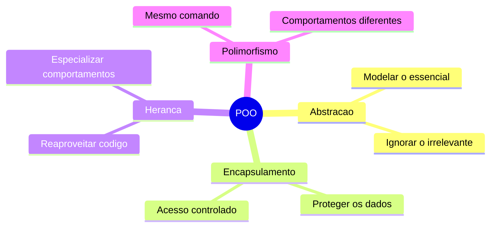

[Índice](../../README.md) | [← Anterior: 1. Introdução ao Java e ao JDK 25](../01-introducao-java-jdk25/README.md) | [Próximo: 3. Classes e Objetos →](../03-classes-e-objetos/README.md)

# 2. Conceitos Fundamentais de POO

> **O que você vai aprender neste capítulo:**
> Entender o que é Programação Orientada a Objetos, por que ela existe, quais são os 4 pilares é como pensar em termos de objetos antes mesmo de escrever código.

Imagine que você precisa construir um sistema para uma escola. Na abordagem procedural, você escreveria funções como `calcularMedia(notas)`, `salvarAluno(dados)`, `imprimirBoletim(aluno)` — funções soltas, sem conexão clara entre si. Na Programação Orientada a Objetos, você cria um `Aluno` que já sabe calcular sua própria media, guardar seus próprios dados e imprimir seu próprio boletim. O código fica mais organizado, mais fácil de entender é mais fácil de manter.

POO não é só uma técnica de programação — e uma forma de pensar o mundo. Cada entidade do problema vira um objeto com características próprias e comportamentos próprios. Antes de ver qualquer linha de código Java, entender esses conceitos vai fazer toda a diferença no seu aprendizado.


## 2.1 O que é Programação Orientada a Objetos?

Imagine que você precisa organizar o cadastro de uma escola. Na programação procedural, você teria funções soltas espalhadas pelo código. Na POO, você cria um objeto `Aluno` que carrega seus próprios dados e sabe o que fazer com eles.

```
Procedural                    Orientado a Objetos
-----------                   -------------------
calcularMedia(notas)          aluno.calcularMedia()
exibirDados(nome, idade)      aluno.exibirDados()
salvarAluno(dados)            aluno.salvar()

Funcoes soltas                Tudo dentro do objeto
Dados e acoes separados       Dados e acoes juntos
```

## 2.2 Os 4 Pilares



| Pilar | Analogia | Quando veremos |
|---|---|---|
| **Abstração** | Ficha de cadastro — guarda só o essencial | Temas 3-4 |
| **Encapsulamento** | Painel do carro — você acelera pelo pedal, sem mexer no motor | Tema 6 |
| **Herança** | Biologia — filho herda características do pai | Tema 7 |
| **Polimorfismo** | O verbo "falar" — cada animal fala diferente | Tema 8 |

## 2.3 Classe vs Objeto — A analogia da forma de bolo

```
CLASSE (forma de bolo)            OBJETO (o bolo pronto)
----------------------            ----------------------
Define como sera o bolo           É o bolo em si
Existe uma so vez                 Podem existir varios
Nao ocupa espaco no forno         Ocupa espaco no prato
É o molde                         E a instancia

class Aluno { }                   new Aluno()
class Aluno { }                   new Aluno()  <- outro, independente
class Aluno { }                   new Aluno()  <- outro, independente
```

---

[Índice](../../README.md) | [← Anterior: 1. Introdução ao Java e ao JDK 25](../01-introducao-java-jdk25/README.md) | [Próximo: 3. Classes e Objetos →](../03-classes-e-objetos/README.md)
