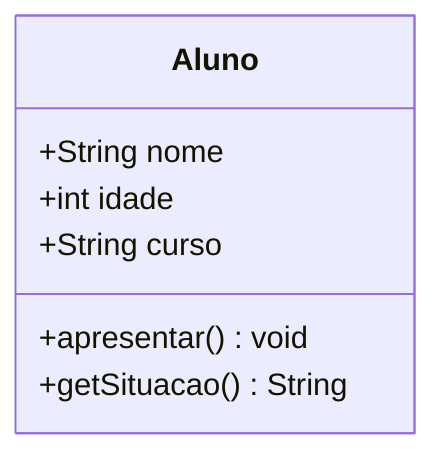

[Índice](../../README.md) | [← Anterior: 2. Conceitos Fundamentais de POO](../02-conceitos-fundamentais-poo/README.md) | [Próximo: 4. Atributos e Métodos →](../04-atributos-e-metodos/README.md)

# 3. Classes e Objetos

> **Códigos deste capítulo:** [codigos/03-classes-e-objetos](../../codigos/03-classes-e-objetos/)

> **O que você vai aprender neste capítulo:**
> Criar suas primeiras classes em Java, entender a diferença entre classe e objeto, instanciar objetos com `new` e trabalhar com múltiplos objetos independentes.

Chegamos ao coracao da POO. Classe e objeto são os conceitos mais fundamentais de toda a programação orientada a objetos — tudo o mais que veremos neste guia (herança, polimorfismo, interfaces) e construido sobre essa base.

Pense assim: uma classe é como uma planta arquitetonica — ela descreve como um predio vai ser, mas não é o predio em si. O objeto e o predio construido a partir daquela planta. Você pode construir varios predios identicos a partir da mesma planta, e cada um vai ter sua própria existencia, seus próprios moradores, seu próprio endereco.

Em Java, você define a planta uma vez (a classe) e pode criar quantos objetos quiser a partir dela. Cada objeto existe de forma independente na memória do computador, com seus próprios dados.


## 3.1 Visualizando uma Classe — Diagrama UML

Antes de escrever código, veja como uma classe e representada visualmente:

```
+---------------------------+
|          Aluno            |  <- Nome da classe
+---------------------------+
| - nome    : String        |  <- Atributos (dados)
| - idade   : int           |
| - curso   : String        |
+---------------------------+
| + apresentar() : void     |  <- Metodos (comportamentos)
| + getSituacao() : String  |
+---------------------------+
```

> **Convenção UML:**
> - `-` = privado (private)
> - `+` = público (public)
> - `#` = protegido (protected)



## 3.2 Criando uma classe

```java
// Arquivo: Aluno.java

class Aluno {

    // ATRIBUTOS: características do objeto
    String nome;
    int    idade;
    String curso;

    // MÉTODO void: executa uma ação, não retorna nada
    void apresentar() {
        IO.println("Nome:  " + nome);
        IO.println("Idade: " + idade);
        IO.println("Curso: " + curso);
    }

    // MÉTODO com retorno: devolve um valor a quem chamou
    String getSituacao() {
        return idade >= 18 ? "Maior de idade" : "Menor de idade";
    }
}
```

## 3.3 Criando objetos (instanciando)

```java
// Arquivo: ProgramaAluno.java

void main() {

    // "new" cria o objeto na memória
    // Tipo variável = new Tipo();
    Aluno a1 = new Aluno();
    Aluno a2 = new Aluno();   // objeto independente do a1

    // Atribuindo valores: objeto.atributo = valor;
    a1.nome  = "Maria Silva";
    a1.idade = 20;
    a1.curso = "Informatica para Internet";

    a2.nome  = "Joao Santos";
    a2.idade = 22;
    a2.curso = "Sistemas para Internet";

    // Chamando métodos: objeto.método();
    IO.println("=== Aluno 1 ===");
    a1.apresentar();
    IO.println("Situacao: " + a1.getSituacao());

    IO.println("=== Aluno 2 ===");
    a2.apresentar();
}
```

```
# Saida:
=== Aluno 1 ===
Nome:  Maria Silva
Idade: 20
Curso: Informatica para Internet
Situacao: Maior de idade
```

> **Ponto chave:** cada objeto e **independente**. Mudar `a1.nome` não afeta `a2.nome`. Eles compartilham o molde (classe), mas cada um tem sua **própria copia** dos atributos na memória.

## 3.4 Múltiplos objetos — exemplo prático

```java
// Arquivo: Loja.java

class Produto {
    String nome;
    double preco;
    int    estoque;

    void exibir() {
        IO.println(nome + " — R$ " + preco + " (estoque: " + estoque + ")");
    }
}

void main() {
    var p1 = new Produto();
    var p2 = new Produto();
    var p3 = new Produto();

    p1.nome = "Mel de Abelha";     p1.preco = 25.00; p1.estoque = 50;
    p2.nome = "Castanha de Caju";  p2.preco = 18.50; p2.estoque = 200;
    p3.nome = "Rapadura";          p3.preco =  5.00; p3.estoque = 100;

    Produto[] catalogo = { p1, p2, p3 };

    IO.println("=== CATALOGO DA LOJA ===");
    for (int i = 0; i < catalogo.length; i++) {
        catalogo[i].exibir();
    }
}
```

**Entendendo o trecho final:**

- `Produto[] catalogo = { p1, p2, p3 };` cria um **array** (vetor) do tipo `Produto` com 3 posições, já preenchido com os três objetos criados antes. Fica assim na memória: `catalogo[0] = p1`, `catalogo[1] = p2`, `catalogo[2] = p3`. É uma forma de agrupar vários objetos relacionados numa única estrutura, em vez de manipular `p1`, `p2` e `p3` separadamente.

- O laço `for (int i = 0; i < catalogo.length; i++)` percorre o array pelo índice: `i` começa em `0`, e o laço repete enquanto `i` for menor que `catalogo.length` (o tamanho do array — nesse caso, 3). A cada volta, `i` é incrementado em 1.

- Dentro do laço, `catalogo[i]` acessa o objeto que está naquela posição do array, e `.exibir()` chama o método daquele objeto especificamente.

Na prática, o laço executa assim:

```
i = 0  →  catalogo[0].exibir()  →  exibe p1 (Mel de Abelha)
i = 1  →  catalogo[1].exibir()  →  exibe p2 (Castanha de Caju)
i = 2  →  catalogo[2].exibir()  →  exibe p3 (Rapadura)
i = 3  →  3 < 3 é falso → o laço para
```

> **Alternativa mais enxuta:** o Java também permite escrever esse mesmo laço com a forma **for-each**: `for (Produto p : catalogo) { p.exibir(); }`. Ela é mais curta porque dispensa o índice `i` e o `.length` — o Java cuida disso por trás dos panos. Use o `for` com índice quando precisar saber a posição do item (por exemplo, para numerar a lista); use o for-each quando só precisar acessar cada item, sem se importar com a posição.

## Erros comuns — Tema 3

```java
// ERRO 1: esquecer o "new"
Aluno a = Aluno();         // ERRADO
Aluno a = new Aluno();     // CORRETO

// ERRO 2: nome da classe diferente do arquivo
// Arquivo se chama "aluno.java" (minúsculo)
// Classe se chama "Aluno" (maiúsculo)
// -> ERRO: o nome do arquivo deve ser idêntico ao da classe pública

// ERRO 3: acessar atributo sem criar o objeto
Aluno a;
a.nome = "Maria";          // ERRADO: NullPointerException!
Aluno a = new Aluno();
a.nome = "Maria";          // CORRETO

// ERRO 4: comparar Strings com ==
String s1 = "Maria";
String s2 = "Maria";
if (s1 == s2)              // ERRADO: compara referências de memória
if (s1.equals(s2))         // CORRETO: compara o conteúdo
```

## Exercícios — Tema 3

> **Exercício 3.1** — Crie a classe `Livro` com: `titulo`, `autor`, `anoPublicacao`, `preco`. Método `exibirInfo()`. Instancie 3 livros.
>
> **Exercício 3.2** — Crie `Carro` com: `marca`, `modelo`, `ano`, `velocidadeAtual`. Métodos `acelerar(int km)` e `frear(int km)`. Mostre a velocidade após cada ação (não permita negativo).
>
> **Exercício 3.3 (Projeto progressivo)** — Crie `Artesao` com: `nome`, `cidade`, `tecnica`, `precoPecaMedia`. Instancie 4 artesaos nordestinos. **Guarde este exercício — você vai evoluir este sistema nos próximos temas.**

---

[Índice](../../README.md) | [← Anterior: 2. Conceitos Fundamentais de POO](../02-conceitos-fundamentais-poo/README.md) | [Próximo: 4. Atributos e Métodos →](../04-atributos-e-metodos/README.md)
