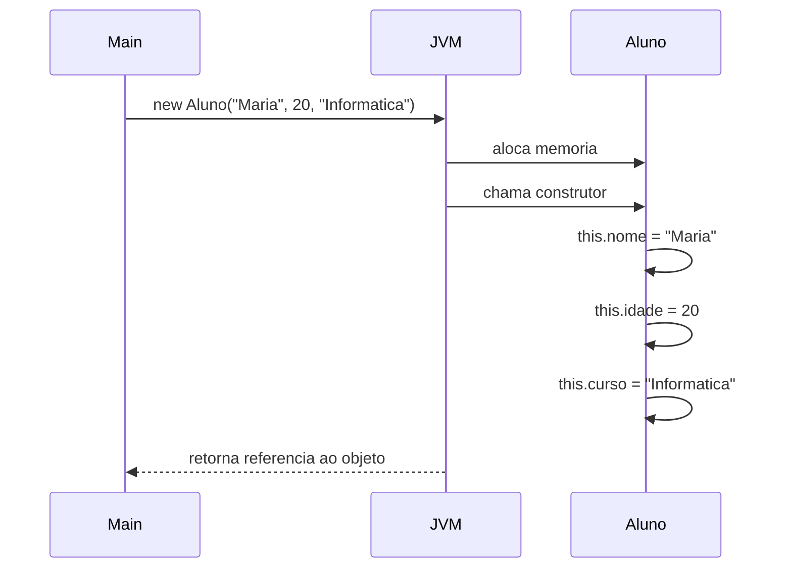

[Índice](../../README.md) | [← Anterior: 4. Atributos e Métodos](../04-atributos-e-metodos/README.md) | [Próximo: 6. Encapsulamento →](../06-encapsulamento/README.md)

# 5. Construtores

> **Códigos deste capítulo:** [codigos/05-construtores](../../codigos/05-construtores/)

> **O que você vai aprender neste capítulo:**
> Entender o que é um construtor, por que ele existe, como criar construtores com diferentes parâmetros, usar `this()` e `super()`, e conhecer os Records do JDK 25.

Imagine que você contrata um funcionario e ele chega no primeiro dia sem saber seu nome, sem ter acesso ao sistema, sem conhecer o cargo. Alguem precisaria preencher tudo isso manualmente depois. Seria caotitico.

Com objetos é a mesma coisa. Sem um construtor, o objeto nasce "vazio" — `nome = null`, `saldo = 0`, `ativo = false` por padrao. Você precisaria lembrar de configurar cada atributo manualmente toda vez. É fácil esquecer algum campo e criar bugs difíceis de rastrear.

O **construtor** resolve isso. Ele é executado automaticamente quando o objeto é criado com `new`, garantindo que o objeto nasça já em um estado válido e coerente. É como uma lista de verificação de admissão: antes do funcionário começar a trabalhar, todos os dados já estão preenchidos e conferidos.


## 5.1 O problema sem construtor

```java
// Sem construtor, o objeto nasce "vazio"
var a = new Aluno();
// a.nome = null, a.idade = 0, a.curso = null
// Você precisa lembrar de preencher tudo manualmente
// E fácil esquecer algum campo!
```

## 5.2 Construtor resolve o problema

```java
// Com construtor, o objeto nasce já preenchido
var a = new Aluno("Maria", 20, "Informatica");
// Impossível criar um Aluno sem nome e curso!
```



```java
// Arquivo: Construtores.java

class Aluno {
    private String nome;
    private int    idade;
    private String curso;
    private String matricula;

    // CONSTRUTOR PADRÃO: executado quando new Aluno()
    Aluno() {
        this.curso     = "Nao informado";
        this.matricula = "0000";
    }

    // CONSTRUTOR COM PARÂMETROS
    Aluno(String nome, int idade, String curso) {
        // "this" diferencia o atributo do parâmetro de mesmo nome
        this.nome      = nome;
        this.idade     = idade;
        this.curso     = curso;
        this.matricula = gerarMatricula();
    }

    // CONSTRUTOR COMPLETO
    Aluno(String nome, int idade, String curso, String matricula) {
        this(nome, idade, curso); // chama o construtor acima
        this.matricula = matricula;
    }

    private String gerarMatricula() {
        return "2025" + (int)(Math.random() * 9000 + 1000);
    }

    void apresentar() {
        IO.println("---");
        IO.println("Nome:      " + nome);
        IO.println("Idade:     " + idade);
        IO.println("Curso:     " + curso);
        IO.println("Matricula: " + matricula);
    }
}

void main() {
    var a1 = new Aluno("Maria Silva", 20, "Informatica para Internet");
    var a2 = new Aluno("Joao Santos", 22, "Sistemas", "2025-0042");

    a1.apresentar();
    a2.apresentar();
}
```

## 5.3 Records (JDK 25)

Um `record` é um tipo especial de classe do Java, criado para reduzir a repetição de código quando o objetivo é apenas **guardar dados**. É ideal para classes que representam algo simples e fixo — um produto, um endereço, um município — sem lógica complexa por trás.

```java
record Produto(String nome, double preco, int estoque) {}
```

Essa única linha substitui o que, numa classe tradicional, exigiria dezenas de linhas: atributos privados, um construtor, getters para cada atributo, além de `toString()`, `equals()` e `hashCode()`. O Java gera tudo isso **automaticamente** por trás dos panos:

- **Construtor** — já pronto, recebendo os atributos na ordem declarada
- **Getters** — um método para cada atributo, mas sem o prefixo `get`. Em vez de `getNome()`, é só `nome()`
- **`toString()`** — formatado automaticamente como `Produto[nome=..., preco=..., estoque=...]`, útil para depuração
- **`equals()` e `hashCode()`** — comparam dois records pelo conteúdo dos atributos, não pela referência de memória

> **Imutabilidade:** uma vez criado um `Produto`, não é possível alterar `nome`, `preco` ou `estoque` depois — não existem setters. Isso é intencional: records representam dados que, uma vez definidos, não deveriam mudar (diferente de uma `ContaBancaria`, por exemplo, onde o saldo muda o tempo todo).

### Sem record vs com record

Para ver com clareza o que o Java está economizando, compare a mesma classe `Produto` escrita das duas formas:

```java
// Arquivo: SemRecord.java
// Classe tradicional: TUDO escrito manualmente

class Produto {
    private final String nome;
    private final double preco;
    private final int estoque;

    Produto(String nome, double preco, int estoque) {
        this.nome    = nome;
        this.preco   = preco;
        this.estoque = estoque;
    }

    String getNome()   { return nome; }
    double getPreco()  { return preco; }
    int    getEstoque(){ return estoque; }

    @Override
    public String toString() {
        return "Produto[nome=" + nome + ", preco=" + preco + ", estoque=" + estoque + "]";
    }

    @Override
    public boolean equals(Object obj) {
        if (this == obj) return true;
        if (!(obj instanceof Produto)) return false;
        Produto p = (Produto) obj;
        return nome.equals(p.nome) && preco == p.preco && estoque == p.estoque;
    }

    @Override
    public int hashCode() {
        return java.util.Objects.hash(nome, preco, estoque);
    }
}

void main() {
    var p1 = new Produto("Mel de Abelha", 25.00, 100);
    IO.println(p1.getNome());
    IO.println(p1);
}
```

```java
// Arquivo: ComRecord.java
// Record: MESMO resultado, uma linha

record Produto(String nome, double preco, int estoque) {}

void main() {
    var p1 = new Produto("Mel de Abelha", 25.00, 100);
    IO.println(p1.nome());
    IO.println(p1);
}
```

| | Sem record | Com record |
|---|---|---|
| Linhas de código | ~30 | 1 |
| Construtor | Escrito à mão | Gerado automaticamente |
| Getters | Um método por atributo, escrito à mão | Gerados automaticamente (`nome()`, `preco()`...) |
| `toString()` | Escrito à mão | Gerado automaticamente |
| `equals()` e `hashCode()` | Escritos à mão, fáceis de errar | Gerados automaticamente e corretos |
| Setters | Podem ser adicionados se necessário | Não existem — o record é imutável por padrão |
| Resultado ao rodar | Idêntico ao do record | Idêntico ao da classe tradicional |

O comportamento final é **exatamente o mesmo** — a diferença é que na classe tradicional você escreve e mantém manualmente cada método repetitivo, enquanto o record deixa o Java gerar tudo isso por você. É por isso que records são recomendados sempre que a classe for apenas um "pacote de dados", sem regras de negócio complexas.

```java
// Arquivo: UsandoRecords.java
// Record: gera automaticamente construtor, getters,
// toString(), equals() e hashCode()

record Produto(String nome, double preco, int estoque) {}

record Municipio(String nome, String estado, long populacao, double area) {
    // Método personalizado dentro do record
    double densidadeDemografica() {
        return populacao / area;
    }
}

void main() {
    var p1 = new Produto("Mel de Abelha", 25.00, 100);

    // Getters: nome do atributo + ()
    IO.println(p1.nome());    // Mel de Abelha
    IO.println(p1.preco());   // 25.0
    IO.println(p1);           // Produto[nome=Mel de Abelha, preco=25.0, estoque=100]

    var m1 = new Municipio("Caruaru", "PE", 365000, 920.6);
    IO.println(m1.nome() + ": " + String.format("%.1f", m1.densidadeDemografica()) + " hab/km2");
}
```

Repare que `p1.nome()` é chamado como método (com parênteses), não como atributo direto (`p1.nome`) — essa é a diferença visual mais marcante entre um record e uma classe comum com atributos públicos.

O segundo exemplo, `Municipio`, mostra que um record não precisa se limitar aos dados declarados — ele pode ter métodos adicionais, como qualquer classe. `densidadeDemografica()` é calculado a partir dos próprios atributos do record (`populacao` e `area`), sem precisar de parâmetros, porque acessa diretamente os campos que o record já guarda.

> **Quando usar record em vez de classe comum:** sempre que a classe for essencialmente um "pacote de dados" — sem regras de negócio complexas e sem necessidade de encapsulamento com validação nos setters (porque não há setters). Quando você precisa de comportamento mais elaborado, herança, ou atributos que mudam ao longo da vida do objeto, uma classe tradicional continua sendo a escolha certa.

## Erros comuns — Tema 5

```java
// ERRO 1: construtor com tipo de retorno
void Aluno(String nome) { ... }  // ERRADO: "void" não pode!
Aluno(String nome) { ... }       // CORRETO

// ERRO 2: nome do construtor diferente da classe
class Aluno {
    aluno(String nome) { ... }   // ERRADO: deve ser "Aluno" com A maiúsculo
}

// ERRO 3: esquecer o super() em subclasse
class Aluno extends Pessoa {
    Aluno(String nome) {
        // super() não chamado -> ERRO se Pessoa não tem construtor padrão
        this.nome = nome;
    }
}
// CORRETO:
class Aluno extends Pessoa {
    Aluno(String nome, int idade) {
        super(nome, idade); // PRIMEIRO, sempre
    }
}

// ERRO 4: chamar this() depois de outras instrucoes
Aluno(String nome, int idade, String curso) {
    IO.println("Criando aluno..."); // ERRADO: this() deve ser a 1a instrução
    this(nome, idade);
}
```

## Exercícios — Tema 5

> **Exercício 5.1** — Adicione dois construtores a `ContaBancaria`: um só com titular (saldo = 0) e outro com titular e saldo inicial.
>
> **Exercício 5.2** — Crie o record `Municipio(String nome, String estado, long populacao, double area)`. Instancie 5 municipios nordestinos, calcule a densidade demografica de cada um e exiba do mais denso ao menos denso.
>
> **Exercício 5.3 (Projeto progressivo)** — Adicione um construtor completo a `Artesao`. Prove que dois objetos criados com os mesmos dados são objetos diferentes na memória (use `==` e `.equals()`).

---

[Índice](../../README.md) | [← Anterior: 4. Atributos e Métodos](../04-atributos-e-metodos/README.md) | [Próximo: 6. Encapsulamento →](../06-encapsulamento/README.md)
