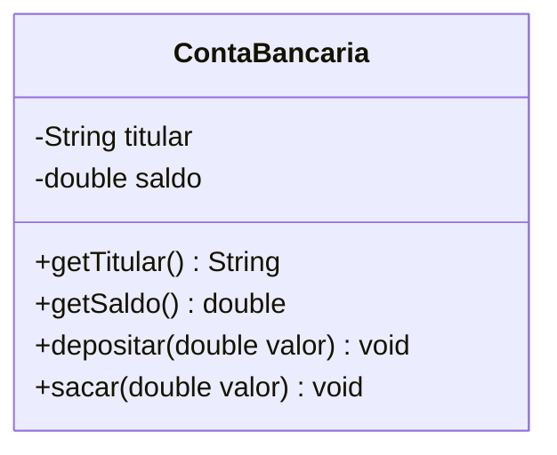

[Índice](../../README.md) | [← Anterior: 5. Construtores](../05-construtores/README.md) | [Próximo: 7. Herança →](../07-heranca/README.md)

# 6. Encapsulamento

> **Códigos deste capítulo:** [codigos/06-encapsulamento](../../codigos/06-encapsulamento/)

> **O que você vai aprender neste capítulo:**
> Entender por que expor atributos diretamente e perigoso, usar `private` para proteger os dados, criar getters e setters com validação, e aplicar os modificadores de acesso corretamente.

Pense no painel de controle de um avião. O piloto acessa os sistemas por botões e alavancas específicas — ele não mexe diretamente nos motores, nos cabos hidráulicos ou nos circuitos. Essa separação existe por segurança: garante que só ações válidas e controladas possam afetar o sistema.

Encapsulamento é exatamente esse princípio aplicado ao código. Quando um atributo é público, qualquer parte do programa pode alterar seu valor diretamente — inclusive para valores absurdos como saldo negativo, nota acima de 10 ou idade negativa. Não há nenhuma barreira de proteção.

Ao tornar os atributos privados e fornecer métodos controlados de acesso, você garante que o objeto sempre esteja em um estado válido. É um dos pilares mais importantes da POO na prática, é o que separa um código amador de um código profissional.


## 6.1 Começando pelo mais simples: nome e idade

Antes de falar de contas bancárias, vamos ver o problema do encapsulamento no menor exemplo possível: um programa que pede o **nome** e a **idade** de uma pessoa e mostra os dois na tela. Primeiro sem encapsulamento, depois com ele.

### Sem encapsulamento

Aqui os atributos da classe não têm `private`. Isso significa que qualquer código fora da classe pode ler e alterar os valores **diretamente**, com `p.idade = ...`.

```java
// Arquivo: SemEncapsulamento.java

class PessoaSemEncapsulamento {
    String nome;   // sem private: qualquer código acessa direto
    int idade;     // sem private: qualquer valor é aceito
}

void main() {
    var p = new PessoaSemEncapsulamento();

    // A idade é atribuída direto no atributo, sem nenhuma verificação
    p.nome  = IO.readln("Digite o nome: ");
    p.idade = Integer.parseInt(IO.readln("Digite a idade: "));

    IO.println("Nome: " + p.nome);
    IO.println("Idade: " + p.idade);
}
```

Saída ao digitar uma idade negativa:

```
Digite o nome: Ana
Digite a idade: -5
Nome: Ana
Idade: -5
```

O programa aceitou `-5` como idade, e isso não faz sentido: ninguém tem idade negativa. Nada na classe impede esse valor, porque o atributo está exposto e quem usa a classe pode colocar qualquer número nele.

### Com encapsulamento (get e set)

Agora os atributos são `private`, ou seja, só a própria classe mexe neles. Quem está de fora usa **getters** (para ler) e **setters** (para escrever). O `setIdade` é o ponto único de controle: só aceita a idade quando ela for maior ou igual a zero.

```java
// Arquivo: ComEncapsulamento.java

class PessoaComEncapsulamento {
    private String nome;   // private: só esta classe acessa
    private int idade;

    // GETTERS: leitura
    public String getNome() { return nome; }
    public int getIdade()   { return idade; }

    // SETTERS: escrita
    public void setNome(String nome) {
        this.nome = nome;
    }

    public void setIdade(int idade) {
        if (idade >= 0) {
            this.idade = idade;               // idade válida: guarda
        } else {
            IO.println("Idade invalida.");    // idade negativa: recusa
        }
    }
}

void main() {
    var p = new PessoaComEncapsulamento();

    // Agora a idade passa pelo setter, que faz a validação
    p.setNome(IO.readln("Digite o nome: "));
    p.setIdade(Integer.parseInt(IO.readln("Digite a idade: ")));

    IO.println("Nome: " + p.getNome());
    IO.println("Idade: " + p.getIdade());

    // p.idade = -5;  // ERRO de compilação: idade é private
}
```

Saída ao digitar uma idade negativa:

```
Digite o nome: Ana
Digite a idade: -5
Idade invalida.
Nome: Ana
Idade: 0
```

Desta vez o `-5` foi recusado e o programa avisou que a idade é inválida. Como o valor foi rejeitado, o atributo `idade` ficou com o valor inicial, `0`. Com uma idade válida, como `20`, o setter guarda o valor normalmente.

O que mudou entre as duas versões:

- Os atributos passaram de abertos para `private`.
- A leitura passou a ser feita por `getNome()` e `getIdade()`.
- A escrita passou a ser feita por `setNome()` e `setIdade()`, e o `setIdade` usa um `if` para validar.
- Tentar `p.idade = -5` direto agora nem compila.

As próximas seções explicam o que são getters e setters com mais detalhe e mostram um exemplo maior, com uma conta bancária.

## 6.2 O problema sem encapsulamento

```
SEM encapsulamento:
   Main --> conta.saldo = -999999   <- qualquer um pode fazer isso!
   Main --> conta.saldo = 0.001
   Main --> conta.saldo = "abc"     <- Java nao deixa, mas a logica fica exposta

COM encapsulamento:
   Main --> conta.sacar(100)        <- passa pela validacao
                |
                v
            if (valor > saldo) -> BLOQUEIA
            if (valor <= 0)    -> BLOQUEIA
            else               -> executa
```



### O que são getters e setters

Depois de tornar um atributo `private`, o resto do programa perde o acesso direto a ele — e é exatamente esse o objetivo. Mas o objeto ainda precisa de alguma forma controlada de **ler** e **alterar** esse valor. É para isso que existem os **getters** e **setters**: métodos públicos que fazem a ponte entre o mundo externo e o atributo privado.

**Getter** — método de **leitura**. Devolve o valor de um atributo privado, sem permitir alterá-lo. Por convenção, o nome começa com `get` seguido do nome do atributo com a primeira letra maiúscula: o atributo `titular` tem o getter `getTitular()`. Para atributos `boolean`, a convenção troca `get` por `is`: um atributo `boolean` chamado `ativa` teria o getter `isAtiva()`, não `getAtiva()`.

**Setter** — método de **escrita**. Recebe um novo valor e o atribui ao atributo privado, mas passando por uma validação antes. Por convenção, o nome começa com `set`: o atributo `idade` tem o setter `setIdade(int idade)`.

```
Sem getter/setter                    Com getter/setter
------------------                   ------------------
obj.saldo             (bloqueado,     obj.getSaldo()      leitura controlada
                       saldo e private)
obj.saldo = valor     (bloqueado)     obj.setSaldo(valor) escrita com validação
```

> **Por que não simplesmente tornar o atributo `public` de novo?** Porque o getter e o setter são um ponto único de controle. Um getter pode formatar o valor antes de devolvê-lo; um setter pode rejeitar valores inválidos (como um saldo negativo). Se o atributo fosse público, qualquer parte do código poderia alterá-lo livremente, sem passar por nenhuma dessas regras — voltando ao problema que o encapsulamento resolve.

Nem todo atributo precisa dos dois. No exemplo abaixo, `saldo` tem getter (`getSaldo()`) mas não tem setter direto — porque a única forma correta de alterá-lo é através dos métodos `depositar()` e `sacar()`, que aplicam as validações de negócio.

```java
// Arquivo: ContaEncapsulada.java

class ContaBancaria {

    // ATRIBUTOS PRIVADOS: acessíveis SOMENTE dentro desta classe
    private String titular;
    private double saldo;

    ContaBancaria(String titular, double saldoInicial) {
        this.titular = titular;
        this.saldo   = saldoInicial;
    }

    // GETTERS: métodos de leitura
    public String getTitular() { return titular; }
    public double getSaldo()   { return saldo; }

    // MÉTODOS DE NEGÓCIO: a única forma de alterar o saldo
    public void depositar(double valor) {
        if (valor > 0) {
            saldo += valor;
        } else {
            IO.println("Valor invalido.");
        }
    }

    public void sacar(double valor) {
        if (valor <= 0) {
            IO.println("Valor invalido.");
        } else if (valor > saldo) {
            IO.println("Saldo insuficiente.");
        } else {
            saldo -= valor;
        }
    }
}

void main() {
    var c1 = new ContaBancaria("Maria Silva", 500.00);
    IO.println("Saldo inicial: R$ " + c1.getSaldo());

    c1.depositar(300.00);
    c1.sacar(100.00);
    c1.sacar(1000.00);  // bloqueado!

    // c1.saldo = -999; // ERRO de compilação: saldo é private

    IO.println("Saldo atual: R$ " + c1.getSaldo());
}
```

Saída:

```
Saldo inicial: R$ 500.0
Saldo insuficiente.
Saldo atual: R$ 700.0
```

## 6.3 Diferença entre private e protected

Esses dois modificadores aparecem o tempo todo em POO e geram confusão no início, porque parecem semelhantes — ambos restringem o acesso. A diferença está em **quem mais pode enxergar o atributo ou método**.

**`private`** — o mais restritivo. Apenas a **própria classe** onde o membro foi declarado pode acessá-lo. Nem uma subclasse (via herança) consegue enxergar um atributo `private` do pai.

**`protected`** — um meio-termo. Além da própria classe, **as subclasses também podem acessar**, mesmo estando em arquivos ou pacotes diferentes. É o modificador natural para atributos que uma classe pai quer compartilhar com quem herda dela, mas ainda proteger do resto do programa.

```java
// Arquivo: PrivateVsProtected.java

class Pessoa {
    private String cpf;      // SÓ Pessoa acessa
    protected String nome;   // Pessoa E suas subclasses acessam

    Pessoa(String nome, String cpf) {
        this.nome = nome;
        this.cpf  = cpf;
    }
}

class Aluno extends Pessoa {
    Aluno(String nome, String cpf) {
        super(nome, cpf);
    }

    void exibir() {
        IO.println(nome);   // OK: protected e visível na subclasse
        // IO.println(cpf); // ERRO: cpf e private em Pessoa, Aluno não acessa
    }
}
```

> **Regra prática:** comece sempre com `private`. Só troque para `protected` quando tiver certeza de que as subclasses vão precisar acessar aquele atributo ou método diretamente. Trocar de `private` para `protected` depois é fácil; o contrário pode quebrar código que já dependia do acesso.

## 6.4 Tabela de visibilidade

| Modificador | Mesma Classe | Mesmo Pacote | Subclasse | Qualquer Lugar |
|---|:---:|:---:|:---:|:---:|
| `private`   | Sim | Não | Não | Não |
| *(padrao)*  | Sim | Sim | Não | Não |
| `protected` | Sim | Sim | Sim | Não |
| `public`    | Sim | Sim | Sim | Sim |

## Erros comuns — Tema 6

```java
// ERRO 1: getter retornando o atributo errado
private String nome;
private int    idade;

public String getNome() { return idade; }  // ERRADO: retorna idade!
public String getNome() { return nome; }   // CORRETO

// ERRO 2: setter sem validação (perde o sentido do encapsulamento)
public void setSaldo(double saldo) {
    this.saldo = saldo; // permite qualquer valor negativo!
}
// Não faca setter de saldo — use depositar() e sacar()

// ERRO 3: "this" desnecessário quando não há ambiguidade
class Aluno {
    private String nome;
    public String obterNome() {
        return this.nome; // funciona, mas "this" e desnecessário aqui
        return nome;      // mais limpo quando não há parâmetro de mesmo nome
    }
}

// ERRO 4: retornar referência de objeto mutável (expõe o interno)
private int[] notas = {8, 7, 9};
public int[] getNotas() { return notas; }  // PERIGOSO: quem recebe pode alterar!
public int[] getNotas() { return notas.clone(); } // CORRETO: retorna cópia
```

## Exercícios — Tema 6

> **Exercício 6.1** — Refatore `Artesao` para encapsulamento completo. Setter de `precoPecaMedia` rejeita valores negativos ou zero.
>
> **Exercício 6.2** — Crie `Estoque` com `quantidade` privada. Métodos `adicionar(int)` e `retirar(int)` com validacoes.
>
> **Exercício 6.3 (Projeto progressivo)** — Encapsule todos os atributos de `Artesao`. Adicione um histórico privado de vendas (`int[]`) com método para registrar nova venda e calcular o total vendido.

---

[Índice](../../README.md) | [← Anterior: 5. Construtores](../05-construtores/README.md) | [Próximo: 7. Herança →](../07-heranca/README.md)
