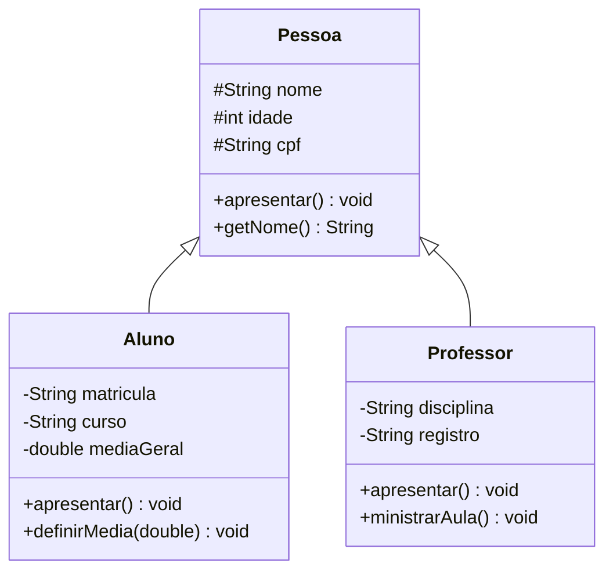
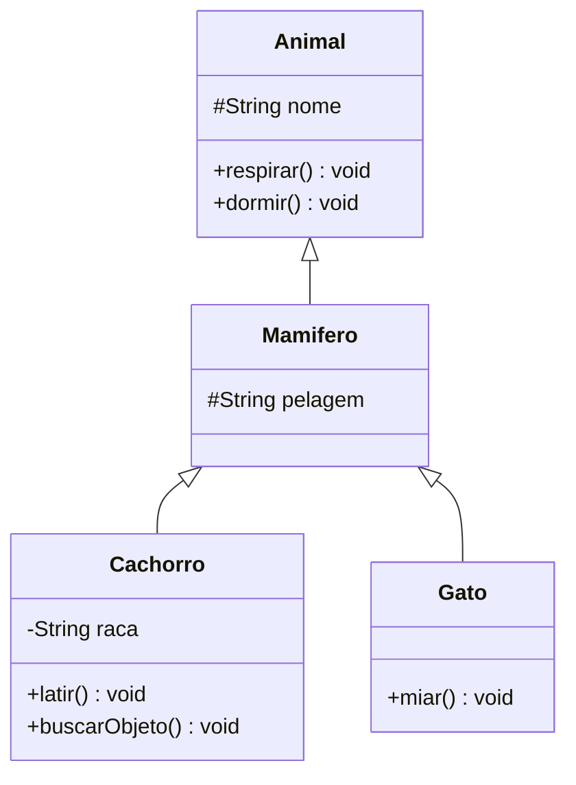

[Índice](../../README.md) | [← Anterior: 6. Encapsulamento](../06-encapsulamento/README.md) | [Próximo: 8. Polimorfismo →](../08-polimorfismo/README.md)

# 7. Herança

> **Códigos deste capítulo:** [codigos/07-heranca](../../codigos/07-heranca/)

> **O que você vai aprender neste capítulo:**
> Criar hierarquias de classes com `extends`, reutilizar código da superclasse, usar `super()` e `super.metodo()`, sobrescrever métodos com `@Override` e entender a relação "E UM".

Na natureza, um Labrador e um cachorro. Um cachorro e um mamifero. Um mamifero e um animal. Cada nível herda as características do nível acima e adiciona as suas próprias. O Labrador não precisa "reinventar" a respiracao — ele herda isso de Animal.

Na programação, herança funciona da mesma forma. Se você já tem uma classe `Pessoa` com nome, idade e CPF, não faz sentido reescrever esses atributos em `Aluno` e em `Professor`. Com herança, tanto `Aluno` quanto `Professor` herdam tudo de `Pessoa` e acrescentam apenas o que é específico de cada um.

Herança e o mecanismo que permite **reaproveitamento de código** de forma organizada e hierarquica. Ela também é a base para o polimorfismo, que veremos no próximo capítulo. Entender herança bem é fundamental para construir sistemas POO robustos e sem repeticao de código.


## 7.1 Visualizando a herança

```
              +----------+
              |  Pessoa  |       <- Superclasse (pai)
              +----------+
              | nome     |
              | idade    |
              | cpf      |
              +----------+
              | apresentar()|
              +----------+
                 /     \
                /       \
    +--------+           +----------+
    |  Aluno |           | Professor|   <- Subclasses (filhos)
    +--------+           +----------+
    | matricula|         | disciplina|
    | curso    |         | registro  |
    +----------+         +----------+
    | apresentar()|      | apresentar()|
    | estudar()   |      | ministrarAula()|
    +-------------+      +----------------+
```



### O que é `@Override`

Repare, no diagrama acima, que tanto `Pessoa` quanto `Aluno` e `Professor` têm um método `apresentar()`. Quando uma subclasse declara de novo um método que já existe na superclasse, isso se chama **sobrescrita** (em inglês, *override*) — a versão da subclasse passa a valer no lugar da versão herdada.

`@Override` é uma **anotação** — um marcador colocado logo acima do método — que avisa ao compilador: *"este método está sobrescrevendo um método que já existe na superclasse"*. Ela não é obrigatória para o código funcionar, mas existe para o **compilador te proteger de erros de digitação**.

```java
class Animal {
    void fazerSom() { IO.println("..."); }
}

class Cachorro extends Animal {
    @Override
    void fazerSom() { IO.println("Au au!"); }   // OK: existe fazerSom() em Animal
}
```

Sem a anotação, um erro de digitação no nome do método passaria despercebido: o Java entenderia como um **método novo**, não como uma sobrescrita, e o programa continuaria compilando normalmente — só que a versão da superclasse continuaria sendo usada, sem nenhum aviso.

```java
class Cachorro extends Animal {
    @Override
    void fazersom() { }   // ERRO de compilação: nao existe fazersom() em Animal
    // O compilador acusa na hora, porque o nome nao bate com nenhum metodo herdado
}
```

> **Regra prática:** sempre que for sobrescrever um método de uma superclasse (ou implementar um método de uma interface, como veremos no Capítulo 9), coloque `@Override` antes. É uma rede de segurança gratuita — se o nome estiver errado, o erro aparece na hora de compilar, em vez de te deixar depurar um bug silencioso depois.

```java
// Arquivo: Herança.java

// SUPERCLASSE
class Pessoa {
    protected String nome;   // protected: acessível nas subclasses
    protected int    idade;
    protected String cpf;

    Pessoa(String nome, int idade, String cpf) {
        this.nome  = nome;
        this.idade = idade;
        this.cpf   = cpf;
    }

    void apresentar() {
        IO.println("Nome:  " + nome);
        IO.println("Idade: " + idade);
        IO.println("CPF:   " + cpf);
    }

    String getNome() { return nome; }
}

// SUBCLASSE: herda tudo de Pessoa
class Aluno extends Pessoa {
    private String matricula;
    private String curso;
    private double mediaGeral;

    Aluno(String nome, int idade, String cpf, String matricula, String curso) {
        super(nome, idade, cpf); // chama o construtor da superclasse — SEMPRE PRIMEIRO
        this.matricula  = matricula;
        this.curso      = curso;
        this.mediaGeral = 0.0;
    }

    void definirMedia(double media) { this.mediaGeral = media; }

    @Override  // garante que estamos realmente sobrescrevendo
    void apresentar() {
        super.apresentar(); // reutiliza o apresentar() de Pessoa
        IO.println("Matricula: " + matricula);
        IO.println("Curso:     " + curso);
        IO.println("Media:     " + mediaGeral);
    }
}

class Professor extends Pessoa {
    private String disciplina;
    private String registro;

    Professor(String nome, int idade, String cpf,
              String disciplina, String registro) {
        super(nome, idade, cpf);
        this.disciplina = disciplina;
        this.registro   = registro;
    }

    @Override
    void apresentar() {
        super.apresentar();
        IO.println("Disciplina: " + disciplina);
        IO.println("Registro:   " + registro);
    }

    void ministrarAula() {
        IO.println(nome + " esta ministrando " + disciplina + ".");
    }
}

void main() {
    var aluno = new Aluno("Maria Silva", 20, "111.222.333-44",
                           "2025-0001", "Informatica para Internet");
    aluno.definirMedia(8.5);

    var prof = new Professor("Adriano Franca", 35, "555.666.777-88",
                              "POO", "SIAPE-12345");

    IO.println("========================================");
    IO.println("ALUNO:");
    aluno.apresentar();

    IO.println("========================================");
    IO.println("PROFESSOR:");
    prof.apresentar();
    prof.ministrarAula();
}
```

## 7.2 Hierarquia de múltiplos níveis



```java
// Arquivo: Hierarquia.java

class Animal {
    protected String nome;
    Animal(String nome) { this.nome = nome; }
    void respirar() { IO.println(nome + " esta respirando."); }
    void dormir()   { IO.println(nome + " esta dormindo."); }
}

class Mamifero extends Animal {
    protected String pelagem;
    Mamifero(String nome, String pelagem) {
        super(nome);
        this.pelagem = pelagem;
    }
}

class Cachorro extends Mamifero {
    private String raca;
    Cachorro(String nome, String pelagem, String raca) {
        super(nome, pelagem);
        this.raca = raca;
    }
    void latir()        { IO.println(nome + ": Au au!"); }
    void buscarObjeto() { IO.println(nome + " buscou o objeto!"); }
}

class Gato extends Mamifero {
    Gato(String nome, String pelagem) { super(nome, pelagem); }
    void miar() { IO.println(nome + ": Miau!"); }
}

void main() {
    var rex  = new Cachorro("Rex",  "caramelo", "Vira-lata");
    var mimi = new Gato("Mimi", "branca");

    rex.respirar();   // herdado de Animal
    rex.latir();      // próprio de Cachorro
    rex.buscarObjeto();

    mimi.respirar();  // herdado de Animal
    mimi.dormir();    // herdado de Animal
    mimi.miar();      // próprio de Gato
}
```

## Erros comuns — Tema 7

```java
// ERRO 1: esquecer o super() no construtor da subclasse
class Aluno extends Pessoa {
    Aluno(String nome, int idade) {
        // super() não chamado -> ERRO se Pessoa não tem construtor padrão!
        this.matricula = "0000";
    }
}

// ERRO 2: tentar herdar de duas classes ao mesmo tempo
class Aluno extends Pessoa, Funcionario { } // ERRADO: Java não tem herança múltipla
// Use interfaces para isso (veja Tema 9)

// ERRO 3: usar private em vez de protected para atributos da superclasse
class Pessoa {
    private String nome; // subclasses NÃO conseguem acessar!
}
class Aluno extends Pessoa {
    void exibir() {
        IO.println(nome); // ERRO: nome e private em Pessoa
    }
}
// Use protected para atributos que subclasses precisam acessar

// ERRO 4: @Override errado
class Cachorro extends Animal {
    @Override
    void Latir() { } // ERRO: "Latir" com maiúsculo não existe em Animal
    // Java vai acusar erro: método não encontrado na superclasse
}
```

## Exercícios — Tema 7

> **Exercício 7.1** — Hierarquia: `Veiculo` -> `VeiculoTerrestre` e `VeiculoAquatico` -> `Carro`, `Moto`, `Barco`.
>
> **Exercício 7.2** — Hierarquia IFPE: `Servidor` -> `Professor` (disciplina, titulacao) e `TecnicoAdministrativo` (setor, cargo).
>
> **Exercício 7.3 (Projeto progressivo)** — Crie uma superclasse `PessoaNordeste` com `nome`, `municipio`, `estado`. Faca `Artesao` herdar dela. Adicione outros tipos: `Comerciante`, `Agricultor`. Exiba todos num array do tipo `PessoaNordeste`.

---

[Índice](../../README.md) | [← Anterior: 6. Encapsulamento](../06-encapsulamento/README.md) | [Próximo: 8. Polimorfismo →](../08-polimorfismo/README.md)
