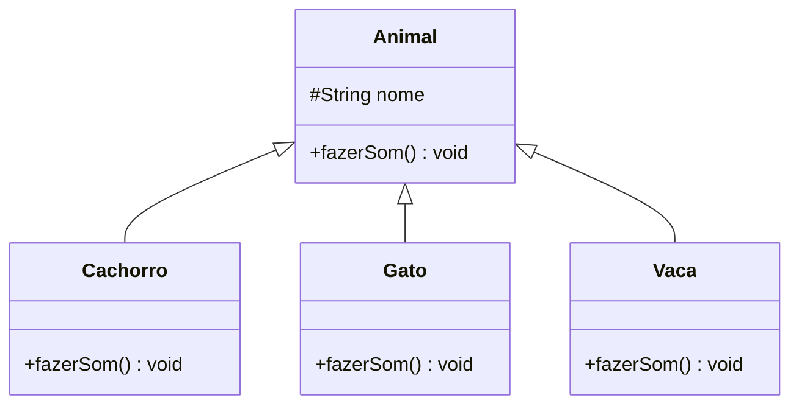

[Índice](../../README.md) | [← Anterior: 7. Herança](../07-heranca/README.md) | [Próximo: 9. Classes Abstratas e Interfaces →](../09-classes-abstratas-e-interfaces/README.md)

# 8. Polimorfismo

> **Códigos deste capítulo:** [codigos/08-polimorfismo](../../codigos/08-polimorfismo/)

> **O que você vai aprender neste capítulo:**
> Entender o que é polimorfismo, sobrescrever métodos com `@Override`, e usar referências da superclasse para objetos de subclasses.

Polimorfismo é talvez o conceito mais elegante da POO. A palavra vem do grego e significa "muitas formas". Na prática, significa que o mesmo comando pode produzir resultados completamente diferentes dependendo de quem o recebe.

Pense no verbo "comunicar". Um ser humano se comunica falando. Um cachorro se comunica latindo. Um golfinho se comunica com sons ultrassonicos. O verbo é o mesmo — a ação e completamente diferente. Se você der a ordem "comunique-se!" para cada um, cada um vai responder a sua maneira.

Em Java, polimorfismo permite que você trate objetos de tipos diferentes de forma uniforme, sem precisar saber exatamente qual e o tipo de cada um. Isso simplifica enormemente o código: em vez de um `if` para cada tipo possível, um único comando funciona para todos. E o resultado de combinar herança com sobrescrita de métodos de forma inteligente.


## 8.1 Visualizando o polimorfismo

```
Antes do polimorfismo: voce precisaria de um IF para cada tipo
    if (animal instanceof Cachorro) cachorro.latir();
    if (animal instanceof Gato)     gato.miar();
    if (animal instanceof Vaca)     vaca.mugir();

Com polimorfismo: um unico comando, Java decide qual usar
    animal.fazerSom(); // automático!
```



```java
// Arquivo: Polimorfismo.java

class Animal {
    protected String nome;
    Animal(String nome) { this.nome = nome; }
    void fazerSom() { IO.println(nome + " faz algum som..."); }
    void dormir()   { IO.println(nome + " esta dormindo."); }
}

class Cachorro extends Animal {
    Cachorro(String nome) { super(nome); }

    @Override
    void fazerSom() { IO.println(nome + ": Au au!"); }
}

class Gato extends Animal {
    Gato(String nome) { super(nome); }

    @Override
    void fazerSom() { IO.println(nome + ": Miau!"); }
}

class Vaca extends Animal {
    Vaca(String nome) { super(nome); }

    @Override
    void fazerSom() { IO.println(nome + ": Muuuu!"); }
}

void main() {
    // Array do tipo Animal aceita qualquer subclasse
    Animal[] animais = {
        new Cachorro("Rex"),
        new Gato("Mimi"),
        new Vaca("Mimosa"),
        new Cachorro("Bolt")
    };

    IO.println("=== Todos os animais fazendo som ===");
    for (Animal a : animais) {
        a.fazerSom(); // Java decide qual versão chamar em tempo de execução
    }

    IO.println("=== Hora de dormir ===");
    for (Animal a : animais) {
        a.dormir(); // não sobrescrito: mesmo comportamento para todos
    }
}
```

## Erros comuns — Tema 8

```java
// ERRO 1: esquecer o @Override (não e erro, mas e ma prática)
class Cachorro extends Animal {
    void fazersom() { } // erro de digitação: "fazersom" != "fazerSom"
    // sem @Override, Java não avisa que você não está sobrescrevendo!

    @Override
    void fazersom() { } // AGORA o compilador avisa do erro
}

// ERRO 2: chamar método específico da subclasse por referência da superclasse
Animal a = new Cachorro("Rex");
a.latir(); // ERRO: Animal não tem latir()!
// Use cast:
((Cachorro) a).latir(); // CORRETO, mas verifique o tipo antes:
if (a instanceof Cachorro) ((Cachorro) a).latir(); // MAIS SEGURO

// ERRO 3: confundir sobrescrita com sobrecarga
class Animal {
    void fazerSom() { }
}
class Cachorro extends Animal {
    void fazerSom(int vezes) { } // SOBRECARGA, não sobrescrita!
    // O fazerSom() original ainda existe e não foi substituído
}
```

## Exercícios — Tema 8

> **Exercício 8.1** — `Funcionario` -> `Gerente` (fixo + bonus), `Vendedor` (comissão), `Tecnico` (fixo + hora extra). Calcule a folha com polimorfismo.
>
> **Exercício 8.2** — `Pagamento` -> `CartaoCredito`, `Boleto`, `Pix`. Método `processar(double valor)` diferente para cada tipo.
>
> **Exercício 8.3 (Projeto progressivo)** — Faca `PessoaNordeste` ter um método abstrato `descricaoProfissional()`. Implemente em `Artesao`, `Comerciante` e `Agricultor` com polimorfismo. Use um array do tipo `PessoaNordeste` para exibir todos.

---

[Índice](../../README.md) | [← Anterior: 7. Herança](../07-heranca/README.md) | [Próximo: 9. Classes Abstratas e Interfaces →](../09-classes-abstratas-e-interfaces/README.md)
